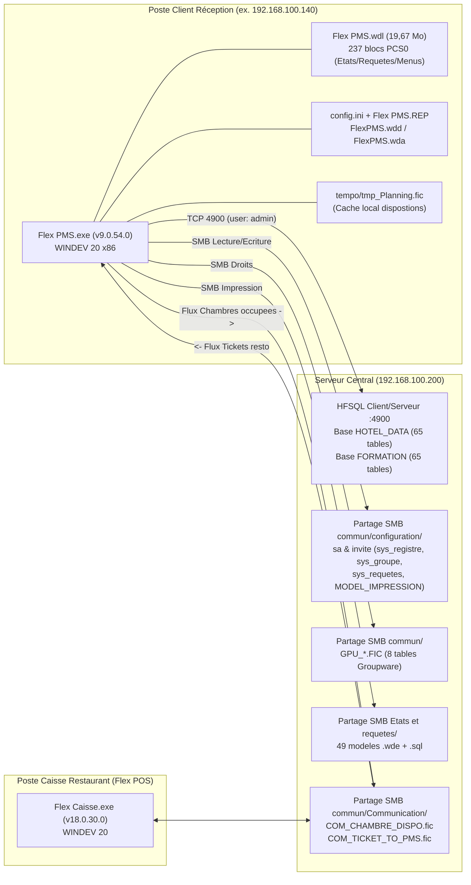

# Audit Fonctionnel & Technique — Flex PMS 9 (Hôtel Makarim Tétouan)
## 02. Modèle de Données (HFSQL) et Architecture Technique & Interface WINDEV

**Date d'audit :** 18/11/2026  
**Sources inspectées (lecture seule absolue) :** `./sources/Flex PMS 9/` (`FlexPMS.wdd`, `FlexPMS.wda`, `backup/FlexPMS.wdd`, `Flex PMS.wdl`, `Flex PMS.REP`, `config.ini`, `COM_CHAMBRE_DISPO.fic/.ndx`, `COM_TICKET_TO_PMS.fic/.ndx`, `tempo/tmp_Planning.fic`, `commun/configuration/sa/*`, `commun/GPU_*.FIC`)  
**Script d'inspection Python livré :** [inspect_windev_metadata.py](file:///C:/Users/HP/Desktop/PMS-PROJET-MAKARIM/Audit_Makarim/scripts/inspect_windev_metadata.py) *(et équivalent d'exécution locale PowerShell/.NET [run_windev_deep_inspect.ps1](file:///C:/Users/HP/Desktop/PMS-PROJET-MAKARIM/Audit_Makarim/scripts/run_windev_deep_inspect.ps1) en l'absence d'interpréteur Python installé sur le poste)*

---

## 0. Architecture technique globale & Constats d'inspection binaire

### 0.1 Topologie de déploiement en production

Flex PMS 9 repose sur une architecture **client lourd 32 bits (WINDEV 20)** connectée à un serveur central **HFSQL Client/Serveur** et à un **partage réseau SMB** hébergeant les fichiers HFSQL Classic de configuration, la gestion des droits utilisateurs (GPU), les modèles d'impression externes `.wde` et le bus d'échange avec la caisse restaurant (`Flex Caisse.exe`).



### 0.2 Résultats de l'inspection binaire (`WDD`, `WDA`, `WDL`, `REP`, `NDX`)

| Artefact analysé | Taille | Signature / Format détecté | Informations extraites |
| :--- | :---: | :--- | :--- |
| `FlexPMS.wdd` | 134 581 o | `PCS\0` · WINDEV 20 (`01F200066p`) | Analyse compilée (schéma HFSQL encodé/compressé au format propriétaire PC SOFT). |
| `FlexPMS.wda` | 326 459 o | `PCS\0` · WINDEV 20 (`01F200066p`) | Analyse complète (diagramme MCD/MLD encodé PC SOFT). |
| `backup/FlexPMS.wdd` | 64 255 o | `PCS\0` · WINDEV 18 (`01F180062h`) | Ancienne analyse WINDEV 18 conservée en sauvegarde (04/05/2017). |
| `Flex PMS.wdl` | 19 670 418 o | `PCS\0` · Archive WINDEV 20 | **237 blocs `PCS\0`** recensés : **50 états intégrés** (`type 0x03`, dont `ETAT_*`, `Note_*`, `Fiche_de_bienvenue`, `Bulletin_individuel`, `Confirmation_Reservation`), **183 requêtes compilées** (`type 0x05`, `REQ_*`, `IMP_*`, `SUP_*`, `ServicesActive`, `Reglement_note`, `sys_UserLicences`, `sys_CompteLicence`) et **2 menus** (`MENU_PRINCIPALE`, `MENU_SELECTION_RAPIDE`). |
| `Flex PMS.REP` | 47 319 o | Texte UTF-8 HFSQL REP V7.00 | **Registre exhaustif des 79 tables de l'analyse** (65 tables HFSQL C/S dans `HOTEL_DATA` + 14 tables HFSQL Classic locales/partagées + 1 table commune `tmp_Planning`), avec leur **GUID unique** et leurs chemins de production/historiques (`192.168.100.250` → `192.168.100.200`). |
| Fichiers d'index `.ndx` (slack space WDD) | ~320 Ko cumulés | Index HFSQL | **Découverte forensique majeure :** les tampons d'écriture des `.ndx` (`sys_registre.ndx`, `sys_explorer.ndx`, `sys_groupe.ndx`, `sys_services.ndx`, `sys_composants.ndx`, `P_RACCOURCI.ndx`, `COM_TICKET_TO_PMS.ndx`) contiennent en clair des fragments non compressés de `FlexPMS.wdd` : **12 contraintes d'intégrité référentielle (`Contrainte_*`)**, **12 clés composées d'optimisation (`OptimCleComp_*`)** et **plus de 120 noms exacts de rubriques physiques**. |
| `commun/configuration/sa/sys_registre.FIC/.mmo` | 111 Ko + 12 Ko | HFSQL Classic + Mémo | **92 entrées de menu** (pas fixe de 1 170 octets) et **91 appels WLanguage `Ouvre`/`OuvreFille` (`FEN_*`)**. |

---

## 1. Liste complète des tables de la base de données et leurs colonnes déduites

Le système Flex PMS 9 manipule exactement **90 tables HFSQL physiques** :
- **65 tables métier** hébergées en **HFSQL Client/Serveur** dans `HOTEL_DATA` (`192.168.100.200:4900`).
- **14 tables de configuration, requêtage et interface POS** en **HFSQL Classic** (`.fic`/`.ndx`/`.mmo` partagés ou locaux).
- **3 tables de journalisation/sécurité** (`JournalIdentification`, `JournalOperation`, `P_SECURITEJNL`).
- **8 tables Groupware Utilisateur (`GPU_*`)** gérant les droits par utilisateur, groupe et contrôle d'écran.

> **Convention de lecture :** Dans les tableaux ci-dessous, les rubriques en **`gras`** ont été **extraites textuellement** (depuis les requêtes SQL `sys_requetes.mmo` / `*.sql` et les fragments `.wdd` dans les `.ndx`) ; les rubriques en *italique* sont **déduites** avec certitude des exports Excel/RTF/PDF de production et des captures d'écrans des manuels de formation.

### 1.1 Domaine 1 — Référentiels Hôtel & Paramétrage général (14 tables C/S)

| Table HFSQL | Stockage | GUID HFSQL | Colonnes exactes extraites / *déduites* | Rôle métier |
| :--- | :---: | :--- | :--- | :--- |
| `Hotel` | C/S | `B2FAB9DDA0F34D528D5B23E3F7D0B58C` | *RaisonSociale, Adresse, BP, Ville, Pays, Tel, Fax, Email, SiteWeb, Slogan, RC, ICE, CNSS, Patente, Logo* | Fiche d'identification légale de l'établissement (`FEN_Fiche_Hotel`). |
| `Chambres` | C/S | `24F695491C8E415E93891A3464481513` | **`NUM_CHAMBRE`** (PK), *Etage, CODE_TYPE_CHAMBRE (FK), CodeVue (FK), NbrLits/Capacite, TarifBase, Actif, HorsVente, EtatMenage (LS/LP/OC/HS), Description, Communicante* | Parc physique des chambres (25 chambres à Makarim, dont 24 actives). Cible des FK `Contrainte_Chambres_ROOMING_LIST` et `Contrainte_Chambres_OCCUPAT`. |
| `Type_chambre` | C/S | `BD187A108BED437DAB228B4ADA430015` | **`CODE_TYPE_CHAMBRE`** (PK), *Libelle (DOUBLE, TWINS, TRIPLE, QUADRUPLE, SUITES…), CapaciteMax, TarifDefaut* | Catégories commerciales de chambres (`FEN_Table_Type_chambre`). |
| `Vues_chambre` | C/S | `B1736CBCFFD64D529CE2F6EB642C9F80` | *CodeVue (PK), Libelle (Piscine, Mer, Jardin, Montagne, Boulevard)* | Vues / situations des chambres (`FEN_Table_Vues_chambre`). |
| `Nationalités` | C/S | `B56E440E924841288C16D678561C68ED` | **`IDNationalités`** (PK), *CodeISO (MA, FR, ES…), Libelle, IDGROUPNAT (FK)* | Référentiel des nationalités (`FEN_Table_Nationalités`). |
| `GROUPNAT` | C/S | `C76BD53F027C42208853AD4AF570D05A` | **`IDGROUPNAT`** (PK), **`LIBELLE_NAT`**, **`ORDRE_NAT`** | Regroupement géographique des nationalités et ordre d'affichage statistique (`FEN_Table_GROUPNAT`). |
| `Langue` | C/S | `EF8E83268D234D9DB947E731CA4D7E4A` | *IDLangue (PK), Code, Libelle (ARABE, FRANCAIS, ESPAGNOL, ANGLAIS…)* | Langues parlées par les occupants (`FEN_Table_Langue`). |
| `Segment` | C/S | `EFADBFE1CDCB452B81540905771906B9` | **`IDSegment`** (PK), *Code, Libelle (WALKING, SOCIETES, AGENCES, TO, CENTRALES DE RESERVATION)* | Segmentation commerciale des séjours (`FEN_Table_Segment`). |
| `Piste` | C/S | `235E4350AEA24610A36CE051A6D150C8` | **`IDPiste`** (PK), **`PISTE`**, **`Mobil_Piste`**, *Intitule (DIRECTE, BOOKING, EXPEDIA, E-MAILING…)* | Canal d'acquisition / piste commerciale (`Contrainte_Piste_GESTHOT`, `Contrainte_Piste_F_SYT`). |
| `Classification` | C/S | `93013DCC59DB4CFFB419EDDBB83CA353` | *IDClassification (PK), Code (STD, BASIC, VIP), Libelle* | Classification / typologie client (`FEN_Table_Classification`). |
| `Departement` | C/S | `18EDE7ECD1294E579C87211072063183` | *IDDepartement (PK), Code, Libelle* | Départements / services internes de l'hôtel. |
| `TCHNG` | C/S | `6E015F46FC1D489FA6642D13DE351EA9` | *CodeDevise (EUR, USD, GBP…), DateCours, TauxAchat, TauxVente* | Table des cours de change (`FEN_Table_TCHNG`, `REQ_TCHANGE`). |
| `P_ECHBRE` | C/S | `638F737D8D374DA99A9CB771AD09B6F1` | **`CODE_ETATGH`** (PK — ex. `RSV`, `PRE`, `DEP`, `ANN`, `NSH`), **`ETAT_DEPART`**, **`ETAT_Annulation`**, **`ETAT_NonArrivee`**, **`ETAT_visiblePlanning`**, **`ETAT_Occupee`**, *Libelle, Couleur* | **Table pivot de la machine à états** des réservations et chambres (`Contrainte_Etat_GH_GESTHOT`, `Contrainte_Etat_GH_OCCUPAT`). Index composites `OptimCleComp_ETAT__CODE_`. |
| `P_CCHBRE` | C/S | `E6B425419F0F46658F4046D8F5957F90` | *CodeControle (PK), Libelle, Couleur (LS, LP, OC, HS…)* | Codes de contrôle / états ménage des chambres (`FEN_Table_P_CCHBRE`). |

### 1.2 Domaine 2 — Cardex Clients & Comptes de Facturation (2 tables C/S)

| Table HFSQL | Stockage | GUID HFSQL | Colonnes exactes extraites / *déduites* | Rôle métier |
| :--- | :---: | :--- | :--- | :--- |
| `F_CLIENT` | C/S | `4242840BA0A7454091FB407FF6A7C2DF` | **`CODE_CLIENT`** (PK), **`INTITULE_CLIENT`**, **`PRENOM_CLIENT`**, **`ADRESSE_CLIENT`**, **`CP_CLIENT`**, **`VILLE_CLIENT`**, **`PAYS_CLIENT`**, **`TEL_FIX_CLIENT`**, **`TEL_PORT_CLIENT`**, **`FAX_CLIENT`**, *Email, TypePieceIdentite, NumPieceIdentite (CIN/Passeport), DateNaissance, IDNationalités, Langue1, Langue2, Fumeur, Habitue, Classification, ObservationCardex* | Cardex individuel des occupants / hôtes hébergés (`FEN_Table_F_CLIENT`). |
| `F_CPTFACTURATION` | C/S | `EEBC284995DF473985C2346ECF364465` | **`CPT_FAC`** (PK — ex. `CL00001`, `CL00006`, `CL00014`), *Societe, Adresse, Telephone, TypeCompte (Comptant/Permanent/Débiteur), CodeComptable, Complement (ICE/RC/BP), PlafondCredit, Actif* | Cardex des comptes de facturation : sociétés, agences, TO, OTA et compte générique individuel (`FEN_Table_F_CPTFACTURATION`). |

### 1.3 Domaine 3 — Services, Tarification, Arrangements & Remises (9 tables C/S)

| Table HFSQL | Stockage | GUID HFSQL | Colonnes exactes extraites / *déduites* | Rôle métier |
| :--- | :---: | :--- | :--- | :--- |
| `P_SERVICES` | C/S | `B0DC9D9B02FE4DDCB34BB829F77DC205` | **`CODE_SRV`** (PK — `HEB`, `LSTD`, `PD`, `REST`, `TPT`, `TS`, `LBB`…), *Libelle, PrixUnitaire, TauxTVA, TypeService, CodeGrpSrv (FK → `F_GRPSRV`), CodeGrpFacturation (FK → `F_GROUPFACTURATION`), CompteComptable, EstTaxe, EstExtra, Actif* | Catalogue des prestations, repas, extras et taxes (`FEN_Table_P_SERVICES`). |
| `F_GRPSRV` | C/S | `E34A2EB0571C4E8DAE5FA658F200F8B2` | *CodeGrpSrv (PK), Libelle (Hébergement, Restauration, Taxes, Extras…)* | Groupes analytiques de services (`FEN_Table_F_GRPSRV`, `REQ_DetailJNL_GRPSRV`). |
| `F_GROUPFACTURATION` | C/S | `DF93D5859FC2426887E08BF61711E772` | *CodeGrpFac (PK), LibelleFacturation (`HEBERGEMENT`, `REPAS`, `TAXES`)* | Regroupements d'impression sur les notes/factures standard & compactes (`FEN_Table_F_GROUPFACTURATION`). |
| `P_EARRANG` | C/S | `7591B65A9C3F4F9DB422F365B854018B` | **`CODE_ARRANG`** (PK — `BB-SGL`, `BB-DBL`, `CNBSSP`…), *Libelle, PetitDejInclus, DejInclus, DinerInclus, Actif* | Entête des arrangements / packages hôteliers (`FEN_Table_P_EARRANG`). |
| `P_LARRANG` | C/S | `CFD8676B523A48959E1EDFB3FBB79A23` | *IDLigneArrang (PK), CODE_ARRANG (FK), CODE_SRV (FK), Quantite, PrixUnitaire, Coefficient/Taxe, ModeFacturation (Par chambre / Par pax)* | Composition détaillée d'un arrangement (`REQ_LIGNE_ARRANGEMENT`). |
| `P_ARRGVALID` | C/S | `798B7DB9C1E94696B9B6DA83C9D203D8` | *IDValid (PK), CODE_ARRANG (FK), DateDebut, DateFin, Saison, PrixSaison* | Périodes de validité saisonnières des arrangements (`REQ_ARRANG_LISTEVALID`). |
| `P_ARRG_CPT` | C/S | `E4127194C0734708B3863F41EB83991B` | *IDArrgCpt (PK), CPT_FAC (FK), CODE_ARRANG (FK), TarifNegocie* | Conventions tarifaires associant un compte client/agence à ses arrangements autorisés (`REQ_ARRG_CPTFACTURE`). |
| `Remises` | C/S | `E0DECD0523FA4A9B96F975205EB2239F` | *CodeRemise (PK), Libelle, TauxPourcent, MontantFixe* | Barèmes de remises applicables (`FEN_Table_Remises`). |
| `P_LIB` | C/S | `F7E32BC70F424627829C5455C1672896` | *IDLib (PK), LibellePreEnregistre* | Libellés pré-enregistrés pour la caisse et les notes (`FEN_Table_P_LIB`). |

### 1.4 Domaine 4 — Réservations, Groupes, Rooming List & Occupation (8 tables C/S)

| Table HFSQL | Stockage | GUID HFSQL | Colonnes exactes extraites / *déduites* | Rôle métier |
| :--- | :---: | :--- | :--- | :--- |
| `F_RSV` | C/S | `A7B5395E7BEC4202919E70983EFB01D7` | **`IDGESTHOT`** (PK — N° réservation), **`IDPiste`** (FK), **`CPT_FAC`** (FK), **`IDSegment`** (FK), **`SOCIETE_GH`**, **`CODE_ETATGH`** (FK), *EstGroupe, MasterGroup, DateArrivee, DateDepart, Garantie, Verrouiller, DateOption, Message, Note, Createur, DateCreation* | Entête de dossier de réservation individuelle ou groupe (`GESTHOT`). |
| `F_PRL` | C/S | `CF75F1C2FD69434F97A34AFC2C52CF7A` | *IDPreRooming (PK), IDGESTHOT (FK), NbrChbre, CODE_TYPE_CHAMBRE, PaxParChbre, CODE_ARRANG, IDNationalités, TotalPax* | Pré-rooming list d'un dossier groupe (allocation quantitative par type avant attribution de numéros de chambres). |
| `F_RML` | C/S | `D746606B96134E80A80F68200ACD53B5` | **`IDROOMING_LIST`** (PK), **`IDGESTHOT`** (FK), **`CODE_ETATGH`**, **`ARRIVEE_GH`**, **`DEPART_GH`**, **`DEPARTPREVU_GH`**, **`NBR_NUITS`**, **`NBR_PAX_RL`**, **`NBR_ENFANT_RL`**, **`NUM_CHAMBRE`** (FK), **`CODE_TYPE_CHAMBRE`** (FK), **`CODE_CLIENT`** (FK), **`IDNationalités`** (FK), **`CODE_ARRANG`** (FK), **`PRIX`**, **`Occupant`**, **`CPT_FAC`**, **`MESSAGE_RL`**, **`CREATEUR_RML`**, **`DATECREATION_RML`**, **`MODIFICATION_RML`**, **`DATEMODIF_RML`** | **Table centrale des séjours / chambres réservées** (1 ligne par chambre dans une réservation individuelle ou groupe). 22 colonnes extraites directement de `sys_requetes.mmo`. |
| `F_OCINFO` | C/S | `377D4405190F4F15967B71E289FB3CB2` | *IDOcInfo (PK), **`IDROOMING_LIST`** (FK via `Contrainte_F_RML_F_OCINFO`), CODE_CLIENT, NomComplet, Type (ADULTE/ENFANT), TypePiece, NumPieceIdentite, Nationalite, DateNaissance, Adresse, EstPrincipal* | Liste détaillée des co-occupants (conjoint, accompagnants, enfants) d'une chambre (`REQ_OCI_RML`, `REQ_SUP_OCI`, fiche de police). |
| `F_LAP` | C/S | `BE016773E23D4D7A84C1CDB8800058E5` | **`IDLigne_ARRG_APP`** (PK), **`IDROOMING_LIST`** (FK via `Contrainte_ROOMING_LIST_LIGNE_ARRG_APP`), **`CODE_SRV`**, **`CODE_PRODUIT`**, **`QUANTITE_PRODUIT_ARRG_APP`**, **`PRIX_UNITAIRE_ARRG_APP`**, **`FACTURATION_ARRG_APP`**, **`COEFFICIENT_ARRG_APP`**, *RemisePourcent* | Lignes d'arrangement appliquées à chaque séjour (préfacturation journalière hébergement, repas, taxes — base de la passation Night Audit). |
| `F_OCC` | C/S | `32EE18F35BA74659A592890DD6388955` | **`IDOCCUPAT`** (PK), **`IDROOMING_LIST`** (FK via `Contrainte_ROOMING_LIST_OCCUPAT`), **`NUM_CHAMBRE`** (FK via `Contrainte_Chambres_OCCUPAT`), **`CODE_ETATGH`** (FK via `Contrainte_Etat_GH_OCCUPAT`), **`DATE`** | Matrice chambre × date alimentant le Visual Planning, les contrôles anti-doublon et le calcul de disponibilité (`REQ_OCC`, `REQ_SUP_OCC_EOD`). |
| `F_NSH` | C/S | `62CC11D6FB3F45A190F27886E0F8D3D4` | *IDNoShow (PK), IDGESTHOT, IDROOMING_LIST, DateNoShow, NumChambre, Client, Motif, MontantPenalite, Operateur* | Archive dédiée des non-présentations (No-Show) générée lors de la clôture (`REQ_LST_NSHOW`, `REQ_TCHBRE_NSH`). |
| `T_CHRSV` | C/S | `EBE42AF4D5584CA9B64D02E2F13B6877` | *IDTemp, SessionUser, NUM_CHAMBRE, DateDebut, DateFin* | Table tampon de verrouillage temporaire des chambres en cours de saisie (purgée par `HSupprimeTout(T_CHRSV)` via *Sup. temporaires*). |

### 1.5 Domaine 5 — Caisse, Journal des Ventes, Facturation, Comptabilité & Trésorerie (10 tables C/S)

| Table HFSQL | Stockage | GUID HFSQL | Colonnes exactes extraites / *déduites* | Rôle métier |
| :--- | :---: | :--- | :--- | :--- |
| `F_JNLV` | C/S | `3B5D4458822548C3AB6EF49DC96C75F7` | *IDJnlV (PK)*, **`DATE_JV`**, **`DATE_APPLIC_JV`**, **`NUM_CHAMBRE`**, **`CODE_SRV`**, **`CLOTURE_JV`**, **`IDCodeJournal`**, **`IDFC`** (FK → `F_FC`), **`TRESORERIE`**, **`IDP_MODERGL`**, **`TYPE_OPERATION_JV`** *(Fact./Régl./Déduction)*, **`cacher_JNL`**, **`CREATEUR_JNL`**, *IDROOMING_LIST, Folio (1..5), Libelle, Quantite, PrixUnitaire, TauxTVA, Montant, Beneficiaire, Verrouille, CommentaireDeduction* | **Grand journal des ventes, extras et encaissements.** Cœur de la caisse, des folios et de la Main Courante. 3 clés composées d'optimisation (`OptimCleComp_DATE__CODE_`, `OptimCleComp_DATE__CODE__1`, `OptimCleComp_TRESO_IDCod_CPT_F_DATE_`). |
| `F_FC` | C/S | `D0ED1216F680490FA009296739E5E27F` | **`IdFacture`** (PK), **`NUM_FC`**, **`DATE_FC`**, **`IDGESTHOT`**, **`CPT_FAC`**, **`ETAT_FC`**, **`TOTALHT_FC`**, **`TOTALTVA_FC`**, **`TOTALTTC_FC`**, **`TOTALEXTRA_FC`**, **`TOTALHEBER_FC`**, **`TOTALCOEFFICIENT`** *(Total taxes)*, **`RESTEAPAYE_FC`**, **`FAC_PERMANENT`**, **`FAC_SOLDER`**, **`FACTURER_FC`**, **`FERMER_FC`**, **`FolioRSV`**, **`COMPLEMENT_FC`**, **`COMPLEMENT2_FC`**, **`ADRESS_FC`**, **`OBJET_FC`**, **`CHAMPSLIBRE_FC`**, **`CREATEUR_FC`**, **`DATECREATION_FC`**, **`MODIFICATION_FC`**, **`DATEMODIF_FC`** | **Entête des Notes et Factures** (27 colonnes extraites quasi intégralement de `sys_explorer.ndx`, `solde clients.sql` et `Table REQ_DOC.xls`). |
| `F_FACTURE` | C/S | `D7A7E9C5E2464A1CAB90A19A9735FA48` | *IDFacBackOffice, NumFacture, DateFacture, CPT_FAC, ListeNotesLiees, TotalHT, TotalTVA, TotalTTC* | Consolidation back-office de plusieurs notes en facture globale (`FEN_Facturation`, `REQ_NOTE_FACTURE`). |
| `F_ENTETE_DOC` | C/S | `F0FE61F97BA847C2AAB456B9AF9DAB0F` | **`ED_ID`** (PK), **`ED_DATEDOC`**, **`ED_TYPEDOC`**, **`ED_VALIDER`**, **`ED_CLOTURER`**, **`ED_TRANSFORMER`**, **`ED_LETTRAGE`**, **`ED_COMPTETIER`**, **`ED_INTITULETIER`**, **`ED_INFOTIER`**, **`ED_VALSOLDEDOC`**, **`ED_TOTALHT`**, **`ED_TOTALTTC`**, **`ED_RESTE`**, **`ED_MODEREGLEMENT`**, **`ED_EXPEDITION`**, **`ED_DECLARER`**, **`ED_NBRIMPRISSION`**, **`ED_EXERCICE`**, **`ED_DEPOT_SECONDAIRE`**, **`DP_INTITULE`**, **`PT_ID`**, **`ED_CREATEUR`**, **`ED_MODIFICATION`** | Entête de documents commerciaux partagé avec l'écosystème Creativekeys (Flex CS / Flex POS — liaison tickets). 8 clés composées d'optimisation extraites. |
| `P_SERIE` | C/S | `6421BE7D954641F7BCDAF04B4B2CC15B` | *CodeSerie, Piece (Facture, Note, Avoir), Prefixe, SuffixeAnnee (`/26`), DernierNumero* | Gestion des souches et séquences de numérotation fiscale (`FEN_Table_P_SERIE1`). |
| `P_MODERGL` | C/S | `EED38AE136CC42FEBDBA4E5929F137F3` | **`IDP_MODERGL`** (PK), *CodeMode (`ESP`, `CC`, `CHQ`, `VIR`, `CRD`), Libelle, CompteTresorerieDefaut* | Modes de règlement acceptés (`FEN_Table_P_MODERGL`). |
| `Trésorerie` | C/S | `11589B6D882A455183F52B9EEE6FA045` | *CodeTresorerie (PK), Libelle (`CAISSE RECEPTION`, `BANQUE`), TypeCompte, SoldeInitial* | Comptes de caisse et banque (`FEN_Table_Trésorerie`). |
| `CodeJournal` | C/S | `0801942603A34E248A067DD9C034EF12` | **`IDCodeJournal`** (PK), *Code (`CAI`, `VTE`, `BNQ`), Libelle* | Journaux comptables et de trésorerie (`FEN_Table_CodeJournal`). |
| `P_PLAN_COMPTABLE` | C/S | `98BEFDDC6E324047864D3AA0C9F2A690` | *NumCompte (PK), Intitule, TypeCompte* | Plan comptable marocain CGNC (`FEN_PlanComptable`). |
| `F_SECTION_ANALYTIC` | C/S | `BE05FD65843348ACB586C11B933B0DB3` | **`SA_COMPTE`** (PK), *IntituleSection, CodeAffaire* | Sections analytiques / codes affaires (`FEN_Table_F_SECTION_ANALYTIC`). |

### 1.6 Domaine 6 — Gouvernante, Alertes & Add-on WIFI (6 tables C/S)

| Table HFSQL | Stockage | GUID HFSQL | Colonnes exactes extraites / *déduites* | Rôle métier |
| :--- | :---: | :--- | :--- | :--- |
| `P_LIBTACH` | C/S | `75CD3206AAEF45839E564F285103A120` | *CodeTache (PK), LibelleTache (Recouche, Départ à blanc, Lit bébé…)* | Référentiel des tâches gouvernante (`FEN_Table_P_LIBTACH`). |
| `F_LOSTFOUND` | C/S | `45E6DC1179F74A26BE46FDD88AB44C51` | **`IDF_LOSTFOUND`** (PK), **`Gouvernante_lf`**, *DateDecouverte, NumChambre, DescriptionObjet, Client, StatutRestitution, DateRestitution* | Registre des objets trouvés / perdus (`FEN_Table_F_LOSTFOUND`). |
| `ALERT` | C/S | `E9B2491DD29F4022893484F40FC5C493` | *IDAlert (PK), TypeAlerte, Message, DateHeure, Destinataire, Lu* | Alertes et notifications internes réception/gouvernante. |
| `WF_TYPE` | C/S | `BB1C4987A4AA4F98B75C2385F76E298B` | *IDWFType (PK), Libelle, DureeValidite* | Profils/durées de tickets Wi-Fi. |
| `WF_CODES` | C/S | `1F4388A4D93F422C91B3ACC8A3512E46` | *IDWFCode (PK), CodeWifi, IDWFType, Utilise, IDROOMING_LIST, DateAttribution* | Stock de codes Wi-Fi (`FEN_Table_WF_CODES`, `REQ_GETCODEWIFI`, `REQ_CONTEURCODEWIFI`). |
| `X_codewifi` | C/S | `ADE3FE64791D4F95BEBD5F7BADC79439` | **`IDX_codewifi`** (PK), *CodeWifi, Attribution* | Table d'extension / historique d'attribution des codes Wi-Fi. |

### 1.7 Domaine 7 — Clôture Journalière, Synthèses & Statistiques (9 tables C/S + 1 cache local)

| Table HFSQL | Stockage | GUID HFSQL | Colonnes exactes extraites / *déduites* | Rôle métier |
| :--- | :---: | :--- | :--- | :--- |
| `CLOTURE` | C/S | `B32AD915BA2C40BCA2CFC28589A7C2C3` | **`IDCLOTURE`** (PK), **`DATE_JOUR`**, **`OPERATEUR`** | Journal des clôtures journalières (Night Audit). Parent FK de `F_SYT` et `F_SYT1`. |
| `F_SYT` | C/S | `400C868A287B42C1AEAD2524A1982464` | *IDSYT (PK), IDCLOTURE (FK), IDROOMING_LIST (FK), IDPiste (FK), DateJour, Pax, Nuitees, CA* | Table de synthèse quotidienne multi-axes alimentée au Night Audit (`Contrainte_F_RML_F_SYT`, `Contrainte_Piste_F_SYT`, `Contrainte_CLOTURE_F_SYT`). |
| `F_SYT1` | C/S | `17284911D64C4A86B443FB60D260CF68` | *IDSYT1 (PK), IDCLOTURE (FK via `Contrainte_CLOTURE_F_SYT1`), Date, NbrTotal (25), NbrActive (24), NbrBloque, NbrDisponible, NbrVendu, TauxOccupation* | Synthèse journalière d'occupation (source directe de `Table F_SYT1.xls` et `HAT.xls`, recalculée par `FEN_RECALCULESYT`). |
| `F_SYT2` | C/S | `F1DB2C5738B04F5080B5A0A5B0A199AC` | *IDSYT2 (PK), DateJour, AxeAnalytique (TypeChambre/Segment), Nuitees, Montant* | Synthèse secondaire ventes/occupation par axe. |
| `F_SYT3` | C/S | `CBEC71DC61D94DDA8982B071355E9CFA` | **`IDF_SYT3`** (PK), *DateJour, CumulCA, CumulPax* | Synthèse complémentaire consolidée. |
| `ET_Nationalite` | C/S | `1E874507ABBD427BAA2A4CEAE1A04BB5` | *Date, IDNationalités, NbrArrivees, NbrNuitees, NbrPresents* | Table de travail pour les statistiques tourisme par nationalité (`FEN_ET_NATIONALITE`). |
| `LST_EtatNationalite` | C/S | `0E787326FE124A5EBCA8CA695380BB1F` | *Periode, GroupeNat, Nationalite, Arrivees, Nuitees* | Restitution agrégée par groupe de nationalité (`REQ_RecapEtatNat`). |
| `ETA_STATARR` | C/S | `A28FF6637BCB4C05B99C2FF2A21ACE88` | *Periode, Axe, NbrArrivees, NbrNuitees* | Statistiques d'arrivées (`ETAT_STATISTIQUE_ARRIVEES`, `REQ_StatiqueArriv`). |
| `tmp_Planning` | C/S + Classic (`tempo/`) | `F28E1FCF59444512BE55040ACEB59DC8` | **`IDtmp_Planning`** (PK), **`TYPE_CHAMBRE`** *(DOUBLE, QUADRUPLE, SUITES, TRIPLE)*, **`Date`** *(AAAAMMJJ)*, **`NBR_CHAMBRE`**, clé composée **`TYPE_CHAMBREDATE`** | Cache de disponibilité par type de chambre × jour affiché sous le Visual Planning. |

### 1.8 Domaine 8 — Administration Système, Configuration, GPU, Journalisation & Communication POS (7 C/S + 25 Classic)

| Groupe / Tables | Stockage | Colonnes exactes extraites / Rôle |
| :--- | :---: | :--- |
| **Sessions, Licences & Import (7 C/S) :** `sys_session`, `sys_repsession`, `sys_clientconnectes`, `sys_licences`, `T_PROTECUSER`, `FICHIER_DONNEES` (`FD_INTITULE`), `CHAMP_DONNEES` (`CD_CLE`, `CD_ORDRE`) | C/S (`HOTEL_DATA`) | Gestion des utilisateurs actifs (10 comptes vus dans `Table sys_session.rtf`), suivi des 5 licences concurrentes (`licence.ini` : `IDLicence=712`, `NbrLicence=5`), protection multi-utilisateur et mapping d'importation (`FEN_IMPORTATION`). |
| **Navigation & Framework applicatif (12 Classic) :** `sys_registre`, `sys_groupe`, `sys_explorer`, `sys_services`, `sys_composants`, `sys_requetes`, `sys_param_req`, `MODEL_IMPRESSION`, `P_DOSSIER`, `P_SECURITE`, `P_RACCOURCI`, `Lng` | Classic (`commun/configuration/sa` & `invité`) | Colonnes extraites : `sys_registre` (**`Nom_reg`, `Type_reg`, `Donnees_reg`, `Systeme_reg`, `Date_reg`, `Icon_reg`, `Description_reg`, `Version_reg`, `Titre_reg`, `groupe_application`, `Active_reg`, `Ordre_reg`, `Commande_reg`, `RACCOURCI`, `Fon_reg`, `Titre_reg_EN/ES/AR`, `Description_reg_EN/ES/AR`**) ; `sys_explorer` (**`IDsys_explorer`, `Titre_exp`, `Description_exp`, `Icon_exp`, `Date_exp`, `Cacher_exp`, `Standard_exp`, `Bureau_exp`, `Systeme_exp`, `Node_exp`**) ; `Lng` (FR/ES/EN) ; `MODEL_IMPRESSION` (15 modèles `.wde`) ; `sys_requetes`/`sys_param_req` (requêteur SQL). |
| **Journalisation sécurité (3 Classic) :** `JournalIdentification`, `JournalOperation`, `P_SECURITEJNL` | Classic (local) | Journalisation technique HFSQL des opérations sur `P_SECURITE`. |
| **Groupware Utilisateur WINDEV (8 Classic) :** `GPU_Utilisateur`, `GPU_Groupe`, `GPU_Utilisateur_Groupe`, `GPU_Element`, `GPU_Cible`, `GPU_Configuration`, `GPU_Configuration_Element`, `GPU_HistoriqueConnexion` | Classic (`commun/`) | Contrôle d'accès natif WINDEV (visibilité/grisé par fenêtre et bouton selon groupe utilisateur + historique connexions). |
| **Interface POS ↔ PMS (2 Classic) :** `COM_CHAMBRE_DISPO`, `COM_TICKET_TO_PMS` | Classic (`commun/Communication/`) | Bus d'échange bidirectionnel entre `Flex PMS 9` et la caisse restaurant `Flex Caisse.exe` (voir §1.10). |

### 1.9 Schéma Entité-Relation du cœur métier (basé sur les 12 contraintes FK extraites)

```mermaid
erDiagram
    F_CPTFACTURATION ||--o{ F_RSV : "CPT_FAC"
    Piste ||--o{ F_RSV : "Contrainte_Piste_GESTHOT"
    Segment ||--o{ F_RSV : "IDSegment"
    P_ECHBRE ||--o{ F_RSV : "Contrainte_Etat_GH_GESTHOT"

    F_RSV ||--o{ F_PRL : "IDGESTHOT (Pre-rooming)"
    F_RSV ||--o{ F_RML : "IDGESTHOT (Rooming list)"
    Chambres ||--o{ F_RML : "Contrainte_Chambres_ROOMING_LIST"
    Type_chambre ||--o{ Chambres : "CODE_TYPE_CHAMBRE"
    F_CLIENT ||--o{ F_RML : "CODE_CLIENT"
    Nationalites ||--o{ F_RML : "IDNationalites"
    P_EARRANG ||--o{ F_RML : "CODE_ARRANG"

    P_EARRANG ||--o{ P_LARRANG : "CODE_ARRANG"
    P_EARRANG ||--o{ P_ARRGVALID : "Validite saisonniere"
    F_CPTFACTURATION ||--o{ P_ARRG_CPT : "Conventions"
    P_EARRANG ||--o{ P_ARRG_CPT : "CODE_ARRANG"

    F_RML ||--o{ F_OCINFO : "Contrainte_F_RML_F_OCINFO"
    F_RML ||--o{ F_LAP : "Contrainte_ROOMING_LIST_LIGNE_ARRG_APP"
    P_SERVICES ||--o{ F_LAP : "CODE_SRV"

    F_RML ||--o{ F_OCC : "Contrainte_ROOMING_LIST_OCCUPAT"
    Chambres ||--o{ F_OCC : "Contrainte_Chambres_OCCUPAT"
    P_ECHBRE ||--o{ F_OCC : "Contrainte_Etat_GH_OCCUPAT"

    F_RML ||--o{ F_JNLV : "Lignes ventes/reglements"
    F_FC ||--o{ F_JNLV : "IDFC"
    F_RSV ||--o{ F_FC : "IDGESTHOT"
    P_SERVICES ||--o{ F_JNLV : "CODE_SRV"
    P_MODERGL ||--o{ F_JNLV : "IDP_MODERGL"

    CLOTURE ||--o{ F_SYT : "Contrainte_CLOTURE_F_SYT"
    CLOTURE ||--o{ F_SYT1 : "Contrainte_CLOTURE_F_SYT1"
    F_RML ||--o{ F_SYT : "Contrainte_F_RML_F_SYT"
    Piste ||--o{ F_SYT : "Contrainte_Piste_F_SYT"
```



### 1.10 Analyse détaillée de l'interface POS ↔ PMS (`COM_CHAMBRE_DISPO` & `COM_TICKET_TO_PMS`)

L'intégration entre la réception (`Flex PMS.exe`) et le point de vente restaurant/bar (`Flex Caisse.exe`) s'effectue par **échange asynchrone de fichiers HFSQL Classic** sur le partage réseau `\\192.168.100.200\Creativekeys\Flex PMS 18\commun\Communication\` (référencé dans `Flex PMS.REP` lignes 335–336) :

1. **`COM_CHAMBRE_DISPO.fic` (`GUID: 01844BE437554D4AB554EC3187FF4E89`, 4 560 o) — Flux PMS → POS :**
   - Mis à jour par Flex PMS à chaque check-in / délogement / check-out.
   - L'inspection binaire directe de notre copie isolée révèle **12 enregistrements fixes (pas ~216 octets)** contenant : `[identifiant/statut]` + **`NUM_CHAMBRE` (3 caractères, ex. `101`, `102`, `110`, `111`, `112`, `302`, `303`, `304`, `309`, `310`, `311`)** + **`NOM_OCCUPANT`** (ex. `AICHA LERHRIS/SAEED HAJJAJ`, `YASMINE LAHLOU`, `ABDELMALEK BOUSSENNA`, `BERKANE MERIEM`, etc.).
   - Permet au serveur POS de sélectionner une chambre occupée pour facturer une consommation sur la note d'hôtel (*Charge to Room*).
2. **`COM_TICKET_TO_PMS.fic` (`GUID: F45E31DF0C5746E9A72A30B83E94FA1C`, 2 796 o) — Flux POS → PMS :**
   - File tampon dans laquelle `Flex Caisse.exe` écrit les tickets de restauration/bar mis sur chambre (en lien avec la structure commerciale `F_ENTETE_DOC` dont les rubriques `ED_CREATEUR`, `ED_MODEREGLEMENT`, `ED_RESTE`, `ED_EXERCICE`, `ED_DECLARER`, `ED_NBRIMPRISSION` apparaissent dans son `.ndx`).
   - Flex PMS importe ces tickets en lignes d'extras dans `F_JNLV` (avec `CODE_SRV = 'REST'`, ex. `SIDI ALI 1L`, `SALAD MAKARIM` observés dans `Table REQ_LIGNE_DOC.xls`).
3. **Limites architecturales à corriger dans le futur PMS :** couplage fragile par partage de fichiers SMB (risque de corruption d'index `.ndx` en cas de coupure réseau, perte ou doublon de ticket entre caisse et Night Audit). À remplacer par une **API REST transactionnelle idempotente** (clé d'idempotence = ID ticket POS) ou une base unifiée PostgreSQL/SQL Server.

---

## 2. Arborescence complète des écrans (fenêtres) et actions de l'interface WINDEV

L'interface WINDEV est pilotée dynamiquement par les tables `sys_groupe.FIC` (arborescence des dossiers de menu) et `sys_registre.FIC/.mmo` (**92 entrées actives** associant un code action `Nom_reg`, un libellé multilingue FR/EN/ES/AR et une commande WLanguage `Ouvre` = fenêtre modale ou `OuvreFille` = fenêtre MDI intégrée).

### 2.1 Arborescence complète du Menu Principal (`MENU_PRINCIPALE`)

```text
Flex PMS Manager (Cadre MDI + Barre <Commande> + Onglets Menu / Sélection rapide / Messages)
│
├── 1. Administration
│   ├── Général [MYHOTEL] .......................................... Ouvre("FEN_Fiche_Hotel")
│   ├── Information général
│   │   ├── Nationalité [NATIONALITE] .............................. OuvreFille("FEN_Table_Nationalités")
│   │   ├── Langue [LANGUES] ....................................... OuvreFille("FEN_Table_Langue")
│   │   ├── Segmentation [SEGMENTATION] ............................ OuvreFille("FEN_Table_Segment")
│   │   ├── Classification [CLASSIFICATION] ........................ OuvreFille("FEN_Table_Classification")
│   │   ├── Piste commerciale [PISTECOMMERCIALE] ................... OuvreFille("FEN_Table_Piste")
│   │   ├── Remises [REMISE] ....................................... OuvreFille("FEN_Table_Remises")
│   │   ├── Compte trésorerie [CPTTRESORERIE] ...................... OuvreFille("FEN_Table_Trésorerie")
│   │   └── Cours de change [COURSCHANGE] .......................... Ouvre("FEN_Table_TCHNG")
│   ├── Hôtel
│   │   ├── Vue hôtel [VUEHOTEL] ................................... OuvreFille("FEN_Table_Vues_chambre")
│   │   ├── Type de chbre [TYPECHBRE] .............................. OuvreFille("FEN_Table_Type_chambre")
│   │   └── Chambre [CHBRE] (Ctrl+A) ............................... OuvreFille("FEN_Table_Chambres")
│   ├── Cardex
│   │   ├── Client / Cpt facturation [CPTFACTURATION] .............. OuvreFille("FEN_Table_F_CPTFACTURATION")
│   │   └── Occupant [CLIENT] ...................................... OuvreFille("FEN_Table_F_CLIENT")
│   ├── Constants
│   │   ├── Contrôle des chambres [OCHBRE] ......................... OuvreFille("FEN_Table_P_CCHBRE")
│   │   ├── État des chambres [ECHBRE] ............................. OuvreFille("FEN_Table_P_ECHBRE")
│   │   ├── Libellé tâches [LIBTACHE] .............................. OuvreFille("FEN_Table_P_LIBTACH")
│   │   ├── Services [SERVICES] .................................... OuvreFille("FEN_Table_P_SERVICES")
│   │   ├── Groupe des services [GROUPSRV] ......................... OuvreFille("FEN_Table_F_GRPSRV")
│   │   ├── Arrangement [ARRANGEMENT] (Ctrl+A) ..................... OuvreFille("FEN_Table_P_EARRANG")
│   │   ├── Codes journaux [CODEJOURNAL] ........................... OuvreFille("FEN_Table_CodeJournal")
│   │   ├── Série [SERIE] .......................................... OuvreFille("FEN_Table_P_SERIE1")
│   │   ├── Mode de règlement [MODEREGLEMENT] ...................... OuvreFille("FEN_Table_P_MODERGL")
│   │   ├── Plan comptable [PLANCOMPTABLE] ......................... OuvreFille("FEN_PlanComptable")
│   │   ├── Sections analytiques / Codes affaires [CODESAFFAIRES] .. OuvreFille("FEN_Table_F_SECTION_ANALYTIC")
│   │   ├── Libellé pré-enregistré [LIBPREENREGISTRE] .............. OuvreFille("FEN_Table_P_LIB")
│   │   ├── Groupe / Libellé de facturation [GROUPEFACTURE] ........ OuvreFille("FEN_Table_F_GROUPFACTURATION")
│   │   └── Groupe de nationalité [GROUPNAT] ....................... Ouvre("FEN_Table_GROUPNAT")
│   └── Configuration
│       ├── Sup. temporaires [SUPFICHIERTMP] ....................... HSupprimeTout(T_CHRSV); info("Done")
│       ├── Services composants [SYSSERVICES] ...................... Ouvre("FEN_ServicesComposants")
│       ├── Structure de fichier [SYSFICHIERDONNEE] ................ Ouvre("FEN_Table_FICHIER_DONNEES")
│       ├── Importation des données [SYSIMPORTATION] ............... Ouvre("FEN_IMPORTATION")
│       ├── Requête SQL [REQUETESQL] ............................... Ouvre("FEN_ExecuterSql")
│       ├── Réajustement des cumuls [REAJUSTEMENTDESCUM] ........... Ouvre("FEN_RECALCULESYT")
│       └── Importer modèle d'impression [IMPORTMODELE] ............ Ouvre("FEN_IMPORT_MODEL")
│
├── 2. Réservation
│   ├── Visual planning [VISUALPLANNING] ........................... OuvreFille("FEN_VISUEL_PLANNING")
│   ├── Floor planning [FLOORPLANNING] ............................. OuvreFille("FEN_FloorPlanning")
│   ├── Saisir [SAISIERSV] ......................................... OuvreFille("FEN_RESERV_DISPO")
│   ├── Saisie d'arrhes [ARRHES] ................................... Ouvre("FEN_ARRHES")
│   ├── Modification [MODIFICATIONRSV] ............................. Ouvre("FEN_SELECTION_RSV")
│   └── Groupe
│       ├── Saisie dossier groupe [DOSSIERGROUPE] .................. Ouvre("FEN_RESERV_GROUP", 0)
│       ├── Rooming liste [ROOMINGLISTE] ........................... OuvreFille("FEN_DOSSIER_GROUPE")
│       └── Dossiers en cours [DOSSIERENCOURS] ..................... OuvreFille("FEN_DOSSIER_GROUPE_OPENED")
│
├── 3. Front Office
│   ├── État d'hôtel en cours [ETATDHOTEL] ......................... Ouvre("FEN_TAUX_OCCUPATION")
│   ├── Cardex [CARDEX2] ........................................... OuvreFille("FEN_Table_F_CLIENT")
│   ├── Messages [MESSAGES] ........................................ OuvreFille("FEN_CHAT")
│   ├── Arrivées
│   │   ├── Walking in [WALKINGIN] ................................. OuvreFille("FEN_WALKIN_DISPO")
│   │   ├── Check in [CHECKIN] ..................................... Ouvre("FEN_CHECK_IN")
│   │   └── Délogement [DELOGEMENT] ................................ Ouvre("FEN_DELOG")
│   └── Arrivées groupe
│       ├── Groupes [CHECKINGROUPE] ................................ OuvreFille("FEN_CHECKIN_BLOCK")
│       └── Groupes en cours [DOSSIERGROUPEENCOU] .................. Ouvre("FEN_GROUPE_ENCOURS")
│
├── 4. Caisse
│   ├── Saisie transactions [SAISIETRANSACTIONS] ................... Ouvre("FEN_SAISIE_TRANSACTION", 0, 1)
│   ├── Facturation & Check out [FACTURATION] ...................... Ouvre("FEN_checkOut") / OuvreFille("FEN_NOTE")
│   ├── Check out groupe [CKECKOUTGROUPE] .......................... Ouvre("FEN_CHECKOUT_BLOCK")
│   └── Encaissement [ENCAISSEMENT] ................................ Ouvre("FEN_ENCAISSEMENT", 1)
│
├── 5. Main courante
│   └── Night audit [NIGHTAUDIT] ................................... Ouvre("FEN_END_OF_DAY")
│
├── 6. Gouvernante
│   ├── État de chambre [ETATDESCHAMBRES] .......................... OuvreFille("FEN_Table_EtatChambres")
│   ├── Lost and found [LOSTANDFOUND] .............................. Ouvre("FEN_Table_F_LOSTFOUND")
│   ├── Chambre hors vente [CHAMBREHORSVENTE] ...................... Ouvre("FEN_CHBRE_HORSVENTE")
│   └── Séparer/Grouper chambre [SERPAERCHBRE] ..................... Ouvre("FEN_SeparerChbre")
│
├── 7. Back Office
│   ├── Reprise de facture [REPRISEDEFACTURE] ...................... OuvreFille("FEN_Factures")
│   ├── Facturation [FACCOMPTABLE] ................................. Ouvre("FEN_Facturation")
│   └── Opération trésorerie
│       ├── Encaissement [OPENCAISSEMENT] .......................... Ouvre("FEN_OPERATION_CAISSE", 1)
│       ├── Décaissement [OPDECAISSEMENT] .......................... Ouvre("FEN_OPERATION_CAISSE", -1)
│       ├── Virement Compte à Compte [OPVIREMENTCPT] ............... Ouvre("FEN_OPERATION_CAISSE", 2)
│       └── Journal / Interrogation trésorerie [INTERROGATIONCAISSE] Ouvre("FEN_INT_CAISSE")
│
├── 8. États
│   ├── Gestionnaire des requêtes [REQUETESPARAMETREES] ............ Ouvre("FEN_GESTIONNAIRE_REQUETTE")
│   ├── Dossier groupe [ETDOSSIERGROUPE] ........................... *(Synthèse groupe)*
│   ├── Ventes et encaissements
│   │   ├── Main courante [ETMAINCOURANTE] ......................... Ouvre("FEN_ET_MAIN_COURANTE")
│   │   ├── Détail des ventes [ETDETAILVENTE] ...................... Ouvre("FEN_ET_DETAIL_VENTE")
│   │   ├── État de chiffre d'affaire [ETCA] ....................... Ouvre("FEN_ET_CHIFFRE_AFFAIRE")
│   │   ├── Analyse des ventes - Services [ETANAVENTE] ............. Ouvre("FEN_ET_ANALYSEVENTE")
│   │   ├── Analyse des ventes - Chambres [ETANACHAMBRES] .......... Ouvre("FEN_ET_ANALYSEVENTE_CHAMBRES")
│   │   ├── Extras d'hôtel [ETEXTRAHOTEL] .......................... Ouvre("FEN_ET_EXTRA_HOTEL")
│   │   ├── Documents en cours [ETLISTDOC] ......................... Ouvre("FEN_ET_LST_DOCUMENT")
│   │   └── Contrôle trésorerie [ETCONTROLETRESO] .................. Ouvre("FEN_ET_CONTROLE_TRESORERIE")
│   ├── Réservation
│   │   ├── Disponibilité par Type chbre [TYPECHBREDESPO] .......... OuvreFille("FEN_TYPECHBRE_DISPO", "", "")
│   │   ├── Préparation restaurant [ETRESTAURANT / ETPDJ] .......... Ouvre("FEN_ET_RESTAURANT")
│   │   ├── Liste des réservations [ETRESERVATION] ................. Ouvre("FEN_ET_LST_RESERV")
│   │   ├── Liste des arrivées [ETARRIVEE] ......................... Ouvre("FEN_ET_LST_ARRIVEE")
│   │   ├── Liste des départs [ETDEPART] ........................... Ouvre("FEN_ET_LST_DEPART")
│   │   ├── Liste des annulations [ETANNUL] ........................ Ouvre("FEN_ET_LST_ANNULATION")
│   │   ├── Liste des no-show [ETNOSHOW] ........................... Ouvre("FEN_ET_LST_NOSHOW")
│   │   └── Liste des groupes [ETLISTGROUPE] ....................... Ouvre("FEN_ET_LST_GROUPE")
│   ├── Gouvernante
│   │   └── État des chambres et tâche gouvernante [ETCONTROLEGOUVER] Ouvre("FEN_ET_CONTROLE_GOUV")
│   ├── Clients
│   │   ├── Grand livre client [ETGRANDLIVETIERS] .................. Ouvre("FEN_ET_GRAND_LIVRE_TIERS")
│   │   └── Balance / Situation clients [BALANCETIERS] ............. Ouvre("FEN_ET_BALANCECLIENT")
│   └── Statistiques
│       ├── Occupation et analyse hôtel [ETSTATOCC / ETTABBORD] .... Ouvre("FEN_ET_OCCUPATION") / OuvreFille("FEN_OCC")
│       └── État nationalités [ETSTATNATIO] ........................ Ouvre("FEN_ET_NATIONALITE")
│
└── 9. Add-on → WIFI
    ├── Type de code WIFI [WIFITYPECODE] ........................... *(Paramétrage profils)*
    └── Codes WIFI [WIFICODES / WFDISPO] ........................... OuvreFille("FEN_Table_WF_CODES")
```

### 2.2 Sous-écrans modaux et actions contextuelles clés

En complément des 92 entrées du menu principal, l'analyse des 97 captures d'écran met en évidence **7 fenêtres secondaires modales** et **actions contextuelles critiques** :

| Écran parent | Déclencheur / Action UI | Sous-écran modal / Comportement |
| :--- | :--- | :--- |
| `FEN_VISUEL_PLANNING` | Clic droit sur une barre de réservation | Menu contextuel : *Modifier la réservation sélectionnée*, *Saisie rapide de la transaction*, *Information rapide*, *Verrouiller/Déverrouiller*. |
| `FEN_FloorPlanning` | Boutons `Ouvrir` / `Extrat` sur carte chambre | Ouverture directe de la fiche réservation ou de `FEN_SAISIE_TRANSACTION` pré-remplie sur la chambre. |
| `FEN_RESERV_DISPO` / `FEN_SELECTION_RSV` | Sélection chambre ou `Ouvrir` | **Fiche Réservation** (3 blocs : Séjour/Chambre + Occupants/Conjoint Cardex + Arrangement/Préfacturation + Verrouillage/Garantie) + popup *Sélection Cardex* + popup *Ajouter service* + popup *Saisie d'arrhes*. |
| `FEN_SELECTION_RSV` | Bouton `Corbeille` | Liste des réservations annulées avec action **`Réactiver`** (restauration d'une réservation annulée). |
| `FEN_DOSSIER_GROUPE` | Bouton `Attribution des chambres` | Popup **`Disponibilité chambre (Sélection multiple)`** affichant `Num Chambre`, `Message`, `Etage`, `Nbr Lits`, `Type`, `Vue`, `Etat (LP/LS)` et compteurs `Nbr Chambres groupe`, `Nbr sélectionnée`, `Reste à sélectionnée`. |
| `FEN_checkOut` (`Facturation & Check out`) | Boutons `Facturer`, `Déduction`, `Transfert`, `Folio`, `Libelle`, `Imprimer`, `Nettoyer`, `Paiement`, `Solder`, `Départ Client` | Popups dédiées : **`Transfert des débits`** (radio *Chambres* vs *Facture permanente*), **`Saisie transaction`**, **`Solder la facture`** (`Num. NOTE`, `Date`, `Num. Reservation`, `Folio`, `Compte`, `Société`, `Complement`, `Adresse`, `Occupant`), et prévisualisation WINDEV (`ETAT_JOURNALCLIENT` / Note / Facture avec export Word/Excel/PDF/HTML/XML/Email). |
| `FEN_Factures` (`Reprise de facture`) | Filtres croisés + onglets `Lignes` / `Règlement` | Barre d'outils : ouverture, recherche, actualisation, suppression/annulation, règlement, réimpression, export direct table vers Excel (`Table REQ_DOC ...xls`). |
