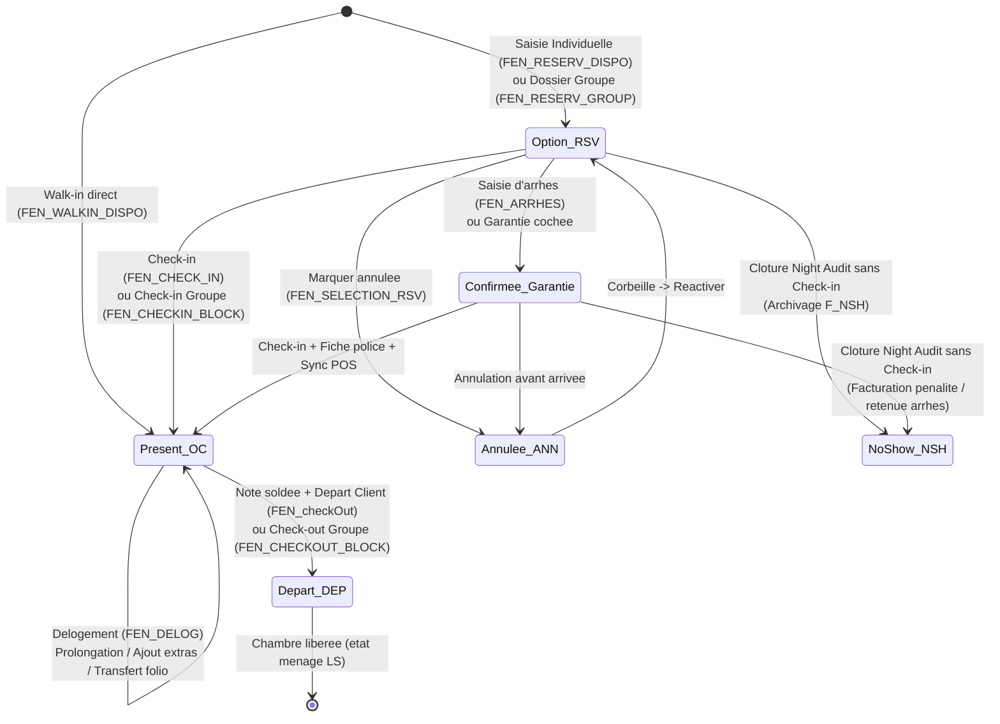
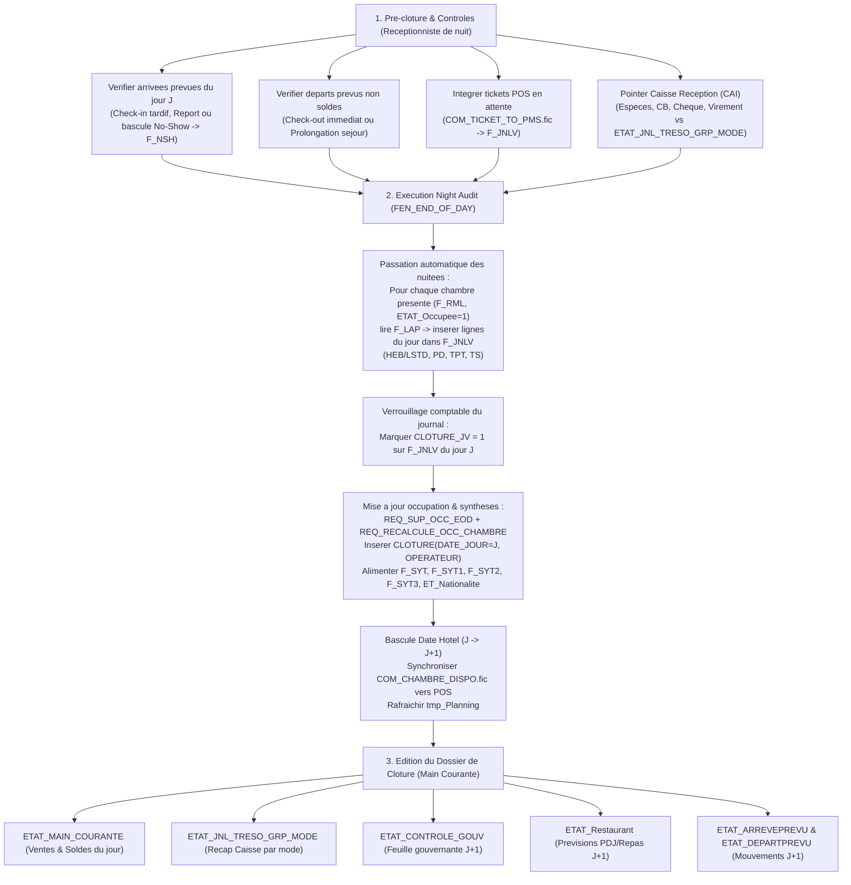

# Audit Fonctionnel & Technique — Flex PMS 9 (Hôtel Makarim Tétouan)
## 03. Spécification des Règles Métier Critiques

**Date d'audit :** 18/11/2026  
**Sources croisées :** 5 Manuels de formation (`.docx` + 97 captures), modèle de données HFSQL (`FlexPMS.wdd` / `.ndx` / `Flex PMS.REP`), 183 requêtes et 50 états `Flex PMS.wdl`, requêtes SQL extraites (`*.sql` + `sys_requetes.mmo`), et 26 exports comptables/réservations réels 2025–2026.

---

## 1. Gestion des réservations (Individuelles, Groupes, Agences/TO, Allotements & Statuts)

### 1.1 Machine à états des réservations (pilotée par `P_ECHBRE`)

Contrairement à un simple champ texte, le cycle de vie des réservations dans Flex PMS 9 est régi par la table paramétrable **`P_ECHBRE`** (`CODE_ETATGH`), référencée par contrainte d'intégrité sur `F_RSV`, `F_RML` et `F_OCC`. L'extraction des métadonnées révèle **5 indicateurs booléens structurants** :

| Rubrique `P_ECHBRE` | Rôle métier exact | Impact planning & facturation |
| :--- | :--- | :--- |
| **`ETAT_visiblePlanning`** | Affiche la barre sur `FEN_VISUEL_PLANNING` et bloque la chambre dans `F_OCC` | Consomme du stock de disponibilité (`Dispo physique`). |
| **`ETAT_Occupee`** | Indique que le client est physiquement présent (*Check-in effectué*) | Alimente `COM_CHAMBRE_DISPO.fic` (POS), déclenche la passation automatique des nuitées au Night Audit (`F_JNLV`) et les prévisions couverts restaurant. |
| **`ETAT_DEPART`** | *« Type de réservation correspond au départ et à la facturation »* | Libère la chambre (`Départ Client`), retire du POS, bascule la chambre en état ménage *Libre Sale* (`LS`). |
| **`ETAT_Annulation`** | Réservation annulée (transférée en *Corbeille*) | Libère immédiatement les nuitées dans `F_OCC`, reste réactivable via `Corbeille → Réactiver`. |
| **`ETAT_NonArrivee`** | Non-présentation (*No-Show*) | Constatée lors du Night Audit, archivée dans `F_NSH`, libère le stock pour la suite du séjour. |

### 1.2 Réservations individuelles — Règles de gestion

1. **Règle d'unicité Cardex obligatoire :** Tout occupant principal doit exister dans **`F_CLIENT`** (Cardex) avant validation de la réservation (recherche par nom ou pièce d'identité, ou création à la volée via `Nouveau`). Les accompagnants (conjoint, adultes supplémentaires, enfants) sont enregistrés dans **`F_OCINFO`** lié à `F_RML` avec : `Nom complet`, `Type` (`ADULTE` / `ENFANT`), `Type & N° Pièce d'identité` (CIN / Passeport), `Nationalité`, `Date de naissance`, `Adresse` et indicateur `Prp.` (occupant principal).
2. **Contrôle de capacité chambre (règle des 3 options) :** Lorsqu'un utilisateur affecte un nombre d'occupants supérieur à la capacité définie sur `Chambres`, le système affiche un avertissement bloquant/informatif proposant exactement 3 choix opérationnels :
   - *(1) Demander à la gouvernante d'ajouter un lit supplémentaire* (facturation code `LBB` / lit sup.),
   - *(2) Changer la chambre*,
   - *(3) Ignorer la notification*.
3. **Verrouillage de chambre (`Verrouiller la réservation`) :** Case à cocher sur la fiche réservation (icône cadenas sur le planning et `FEN_SELECTION_RSV`, accompagnée en production de mentions rouges telles que `A NE PAS DLG` — *à ne pas déloger*). Empêche le déplacement involontaire d'un client VIP ou ayant demandé une chambre précise (ex. « La chambre 307 vu montagne »).
4. **Double qualification commerciale obligatoire :** Chaque réservation est qualifiée par **deux axes indépendants** exploités dans les états de chiffre d'affaires (`ETAT_CA_SEGMENTATION` et `ETAT_CA_PISTECOMMERCIALE`) :
   - **`Segment`** (`WALKING`, `SOCIETES`, `AGENCES`, `TO`, `CENTRALES DE RESERVATION`),
   - **`Piste` / Origine** (`DIRECTE`, `BOOKING`, `EXPEDIA`, `E-MAILING`, `TELEPHONE`).
5. **Annulation réversible (Corbeille) :** Une réservation annulée n'est jamais supprimée physiquement ; elle passe en statut `ETAT_Annulation`, apparaît dans `ETAT_LST_ANNULATION` et peut être restaurée depuis le bouton `Corbeille → Réactiver` sous réserve de disponibilité restante.

### 1.3 Réservations de groupes — Workflow de bout en bout

Le traitement d'un groupe s'appuie sur la cascade **`F_RSV` (Entête Master) → `F_PRL` (Pré-rooming) → `F_RML` (Rooming list) → `F_OCC` (Stock)** :

1. **Contrôle strict de stock à la Pré-rooming list (`F_PRL`) :** Sur `FEN_RESERV_GROUP`, l'utilisateur saisit les dates, lance `Chercher disponibilité` (matrice Type × Jour), puis ajoute des lignes (`Nbr Chbre`, `Type Chambre`, `Pax/Chbre`, `Arrangement`, `Nationalité`). Le système bloque tout dépassement du stock disponible par catégorie (alerte observée : *« ATTENTION! VOUS NE POUVEZ PAS DÉPASSER N CHAMBRE(S) DE TYPE … »*).
2. **Attribution des chambres en masse (`FEN_DOSSIER_GROUPE`) :** Depuis la Rooming list (Rack), la fenêtre *Disponibilité chambre (Sélection multiple)* liste toutes les chambres libres de la catégorie demandée avec leur étage, capacité, vue et état ménage (`LP`/`LS`), et suit en temps réel 3 compteurs : `Nbr Chambres groupe`, `Nbr sélectionnée`, `Reste à sélectionnée`.
3. **Clôture / Dé-clôture du dossier groupe :** Verrouille la composition du dossier une fois la rooming list figée.
4. **Arrivée en masse (`FEN_CHECKIN_BLOCK`) & Départ en bloc (`FEN_CHECKOUT_BLOCK`) :**
   - Au check-out groupe, l'utilisateur peut **exclure sélectivement** certaines chambres du départ immédiat (double-clic → elles restent présentes en individuel).
   - Choix obligatoire du mode de facturation des extras : **`Centralisation globale des extras`** (tout regroupé sur la facture Master/permanente) ou **`Centralisation par chambre des extras`** (chaque occupant règle ses propres extras au départ).

### 1.4 Agences, Tour-Opérateurs, Sociétés, OTA & Allotements

L'analyse des comptes clients (`F_CPTFACTURATION`) et des exports 2025–2026 révèle **4 profils de tiers** gérés par le système :

| Profil tiers | Exemple réel Makarim | Règles de gestion & Facturation |
| :--- | :--- | :--- |
| **Individuel comptant** | `CL00001` (*Individuel Hôtel*) | Paiement direct au départ (`Espèces` / `Carte Crédit`), facture immédiate au nom de l'occupant ou de sa société (`ICE` requis en B2B). |
| **OTA / Centrales** | `CL00006` *(Booking / centrales)* | Tarifs nets/commissionnés à décimales variables (ex. `472,61 MAD`, `1 291,48 MAD`, `3 280,21 MAD`), piste `BOOKING` / segment `CENTRALES DE RESERVATION`. |
| **Sociétés en compte / Conventions** | `CL00014` (`ECOMED`), `CL00023` (`SOMAPRED`), `CL00025`, `CL00054`, `CL00058` | Conventions tarifaires dédiées dans `P_ARRG_CPT` ; séjours clôturés en **Notes non soldées** (`Solder = 0`) puis regroupés périodiquement en **facture globale** (`FEN_Facturation` / `FAC_PERMANENT = 1`, règlement par virement/chèque, suivi par `ETAT_BALANCECLIENT` et `REQ_GrandLivreClient`). |
| **Agences de voyages / TO / Administrations** | `CL00033` (*Colchique Voyage*), *Saad Travel*, *Province Tétouan* | Dossiers groupes (`F_RSV` + `F_PRL`), prise en charge hébergement/repas sur compte agence (Folio 1) et extras éventuels sur Folio 2/client. |

- **Allotements, Options & Overbooking :** Dans `Introduction Flex PMS.docx` (section *Tableau de disponibilité par type de chambre*), le système distingue :
  - **Chambres disponibles physiques** (`Dispo` = `# Active - # Bloqué - # Vendu`),
  - **Chambres à la location incluant l'overbooking** (plafond de surbooking autorisé par l'établissement),
  - **Réservations à date d'option** (nombre de réservations non garanties soumises à une date limite de relâche/confirmation).
  - *Lacune constatée :* Flex PMS 9 ne dispose pas d'un module complet de gestion de contrats d'allotements TO (contingents bloqués par période avec *release date* automatique J-7/J-14). À concevoir nativement dans le nouveau PMS.

---

## 2. Tarification, Facturation & Cycles d'Encaissement

### 2.1 Pensions (`BB`, `DP`, `PC`, `AI`), Arrangements & Grilles saisonnières

La tarification repose sur une architecture **à 4 niveaux** (`P_SERVICES` → `P_EARRANG`/`P_LARRANG` → `P_ARRGVALID`/`P_ARRG_CPT` → `F_LAP`) :

1. **Composition des arrangements (`P_EARRANG` + `P_LARRANG`) :**
   - Chaque code arrangement (ex. `BB-SGL`, `BB-DBL`, `CNBSSP`) déclare ses prestations incluses (`Petit déjeuner`, `Déjeuner`, `Dîner` — cochables sur la fiche réservation et alimentant `ETAT_Restaurant`) et sa ventilation interne dans `P_LARRANG` :
     - **Logement seul (RO / `LSTD` / `HEB`) :** hébergement + taxes (`TPT`, `TS`).
     - **Bed & Breakfast (`BB-SGL` / `BB-DBL`) :** hébergement + `PD` (*Petit-déjeuner*, `45,00 MAD/pax` en 2025–2026 à Makarim) + `TPT` + `TS`.
     - **Demi-Pension (`DP`) :** hébergement + `PD` + `DEJ` ou `DIN` + `TPT` + `TS`.
     - **Pension Complète (`PC`) / All-Inclusive (`AI`) :** hébergement + `PD` + `DEJ` + `DIN` (+ boissons/extras inclus en AI) + `TPT` + `TS`. *(Confirmé sur `R.LISTE.xls` : « la pension complet est compris dans le tarif ».)*
2. **Grilles saisonnières (`P_ARRGVALID`) et conventions clients (`P_ARRG_CPT`) :**
   - Les tarifs évoluent par **période de validité saisonnière** (`P_ARRGVALID` : Basse Saison, Moyenne Saison, Haute Saison — ex. `CNBSSP` = *Convention Basse Saison Single Supérieure*, `REQ_ARRANG_LISTEVALID`).
   - Les comptes sociétés/agences disposent de leurs arrangements contractuels filtrés via `P_ARRG_CPT` (`REQ_ARRG_CPTFACTURE`).
3. **Instantané tarifaire modifiable par séjour (`F_LAP`) :**
   - Cliquer sur **`Appliquer l'arrangement`** copie les lignes de `P_LARRANG` dans `F_LAP` pour la chambre concernée.
   - Le réceptionniste peut ensuite surcharger chaque ligne (`Quantité`, `Prix Unitaire`, `Remise %` issue de `Remises`), ajouter ou supprimer un service, et consulter le **`Total prévisionnel`** (`PRIX` dans `F_RML`) ainsi que le **cours de change du jour** (`TCHNG`).
   - *Règle de décomposition observée en production Makarim (2025–2026) :* les tarifs vendus sont des **forfaits TTC ronds** (ex. `300`, `350`, `400`, `450`, `500`, `600`, `700`, `800 MAD`) dont le système déduit `PD` (`45 MAD × pax × nuits`) et `TPT+TS` (`4,30 MAD × pax × nuits`), le solde constituant la part hébergement (`HEB`). Exemple vérifié sur `Table REQ_DOC JUILLET 2026.xls` (`261 /26`, 1 nuit, 1 pax, forfait `450,00 MAD`) : `Hébergement = 400,70` + `PD (Extra) = 45,00` + `Taxes = 4,30` = **`450,00 MAD TTC`**.

### 2.2 Remises, Déductions, Arrhes / Acomptes & Multi-Folios

| Mécanisme | Écran / Table | Règles métier strictes |
| :--- | :--- | :--- |
| **Remises tarifaires** | `Remises` / Fiche Réservation (`R%`) | Remise en % applicable sur une ligne d'arrangement dans `F_LAP` avant facturation. |
| **Déductions (Avoirs partiels / Corrections)** | `FEN_checkOut` → `Déduction` → `F_JNLV` | Saisie en **montant négatif**. **Règle d'audit impérative** (Manuel Caisse) : la saisie d'un **commentaire explicite est obligatoire** pour toute déduction de CA ou de règlement, afin d'assurer la piste d'audit pour les comptables et commissaires aux comptes. |
| **Arrhes & Acomptes** | `FEN_ARRHES` → `F_JNLV` + `F_RSV.Garantie` | Enregistrées avant l'arrivée avec choix du `Folio`, `Mode de règlement`, `Compte de trésorerie` (`CAISSE RECEPTION`), calcul du solde restant en MAD et en %, consultation `TCHNG`, et édition de l'attestation (`Confirmation_Reservation` / `ETAT_Demande_d_arrhes`). Viennent automatiquement en crédit (négatif) sur la note au check-out. |
| **Ventilation sur 5 Folios** | `FEN_checkOut` (`Folio 1`..`5`) & `F_JNLV.Folio` | Permet de scinder jusqu'à 5 notes distinctes par séjour (ex. Folio 1 = Hébergement + PDJ pris en charge par la société ; Folio 2 = Extras personnels réglés par l'occupant). Le bouton `Folio` déplace une ligne d'un folio à un autre. |
| **Transferts de débits** | `FEN_checkOut` → `Transfert` | Deux destinations exclusives : **(1) Vers une autre chambre présente** ou **(2) Vers une Facture permanente / Compte Master** (groupe/salon, avec choix de rattacher à une facture existante ou d'en ouvrir une nouvelle). |

### 2.3 Distinction juridique Note vs Facture, Délogements & No-Shows

1. **Note (Relevé de compte non fiscal) vs Facture définitive :**
   - **`Imprimer` (Note / Relevé) :** document pro-forma / informatif dépourvu de numéro fiscal de facture et de mention `FACTURE`. Trois formats disponibles : **Note globale**, **Édition normale** (par groupe `HEBERGEMENT` / `REPAS` / `TAXES`), **Édition compacte** (une seule ligne agrégée avec libellé personnalisé), ainsi que le relevé détaillé (`ETAT_JOURNALCLIENT`).
   - **`Solder` → Facture finale :** disponible une fois la note réglée (solde = `0,00 MAD`, encaissements saisis en négatif via `Paiement`) ou validée en compte débiteur. **Exige obligatoirement l'adresse de facturation** (`Société`, `Complément` / ICE, `Adresse`, `Occupant`), attribue le numéro séquentiel annuel (`NNN /AA` via `P_SERIE`), verrouille la pièce (`FACTURER_FC = 1`, `FERMER_FC = 1`) et imprime la mention `FACTURE`, le récapitulatif TVA et l'arrêté en toutes lettres en Dirhams.
   - **Reprise de facture (`FEN_Factures`) :** permet de rappeler, réimprimer ou solder a posteriori 6 catégories de pièces (soldée, transférée back-office, en attente débiteur divers, salon/groupe master, au comptant, compte permanent).
2. **Délogement en cours de séjour (`FEN_DELOG`) :**
   - Transfère un client présent (`ETAT_Occupee = 1`) d'une chambre source vers une chambre destination libre sur le reste du séjour, en mettant à jour `F_RML`, `F_OCC`, `COM_CHAMBRE_DISPO.fic` et en conservant la continuité des transactions/folios déjà postés dans `F_JNLV`.
   - Bloque ou alerte si la réservation porte le drapeau **`Verrouiller la réservation`** (`A NE PAS DLG`).
3. **No-Show (`F_NSH`, `ETAT_NSHOW`, `REQ_LST_NSHOW`) :**
   - Toute réservation prévue le jour `J` (`ARRIVEE_GH = J`, `CODE_ETATGH = 'RSV'`) non passée en check-in lors de l'exécution du Night Audit est basculée en statut `ETAT_NonArrivee` (`NSH`), enregistrée dans `F_NSH`, et ses nuitées futures sont libérées dans `F_OCC` pour remise en vente. Les arrhes éventuellement versées peuvent être conservées/facturées en indemnité de non-présentation.

---

## 3. Calcul exact des taxes marocaines & Clôture journalière (Night Audit / Main Courante)

### 3.1 Fiscalité hôtelière marocaine : État réel dans Flex PMS 9 vs Conformité DGI

L'audit croisé des captures d'écran (`20_image20.png`, `05_image5.png`), des requêtes SQL (`PrixMoyenneDeVente.sql`) et des 26 exports comptables 2025–2026 met en évidence les règles fiscales suivantes et **une anomalie majeure à corriger impérativement** :

#### A. Barèmes observés à l'Hôtel Makarim Tétouan

| Taxe / Prestation | Code `P_SERVICES` | Valeur observée en production | Base d'application |
| :--- | :---: | :--- | :--- |
| **TVA Hébergement & Restauration** | `HEB`, `LSTD`, `PD`, `REST` | **10,0 %** | Taux réduit hôtelier et restauration touristique au Maroc (Art. 99 CGI). |
| **Taxe de Promotion Touristique (TPT) + Taxe de Séjour (TS)** | `TPT` + `TS` | **`4,30 MAD` / pax / nuit** (2024–2026) *(était `11,00 MAD` en 2019–2021)* | Par personne assujettie et par nuitée (`NBR_PAX_RL × NBR_NUITS`). Barème municipal/ONMT dépendant du classement hôtelier → **doit être historisé par date d'effet** (jamais codé en dur comme le `11` dans `PrixMoyenneDeVente.sql`). |
| **Petit-déjeuner** | `PD` | **`45,00 MAD` TTC / pax / nuit** (2025–2026) *(était `40,00 MAD` en 2021)* | Inclus dans l'arrangement `BB` ou facturé en extra. |

#### B. Anomalie fiscale critique prouvée dans Flex PMS 9

1. **Preuve visuelle (`20_image20.png`) et mathématique (`Table REQ_DOC JUILLET 2026.xls`) :**
   Dans le paramétrage actuel de Flex PMS 9 (`P_SERVICES`), les codes **`TPT`** et **`TS`** ont été configurés avec **`TVA = 10,0 %`**. En conséquence, pour un séjour de 1 nuit / 1 pax vendu `450,00 MAD TTC` (`400,70 HEB` + `45,00 PD` + `4,30 TPT+TS`) :
   - **Calcul actuel Flex PMS 9 (erroné fiscalement) :**
     $$\text{Total HT}_{\text{Flex}} = \frac{450{,}00}{1{,}10} = 409{,}09\text{ MAD} \quad;\quad \text{Total TVA}_{\text{Flex}} = 40{,}91\text{ MAD}$$
     *(Ici, la TVA de 10 % est prélevée à tort sur les `4,30 MAD` de taxes touristiques, soit `0,39 MAD` de TVA indue par pax/nuit — environ `133,69 MAD` de sur-TVA rien que sur le mois de juillet 2026 : `1 470,60 / 11`.)*
   - De plus, dans `Table REQ_DOC`, les colonnes nommées `T.HT Extrat` (`45,00`) et `T.HT Hébergement` (`400,70`) contiennent en réalité des montants **TTC** tels que `T. Taxes + T.HT Extrat + T.HT Hébergement = Total TTC`.

2. **Formule exacte conforme à la fiscalité marocaine (DGI) — cible du futur PMS :**
   Les taxes touristiques (`TS` et `TPT`) sont des taxes parafiscales/locales collectées pour le compte de l'État/commune et sont **hors champ TVA (`TVA = 0 %`)**. Pour un forfait vendu `P_TTC` incluant les taxes touristiques `TAX = (TS + TPT) × NbrPaxAssujettis × NbrNuits` :
   $$\text{TTC}_{\text{prestations}} = P_{\text{TTC}} - \text{TAX}$$
   $$\text{Total HT} = \frac{\text{TTC}_{\text{prestations}}}{1 + \text{TauxTVA}} = \frac{450{,}00 - 4{,}30}{1{,}10} = 405{,}18\text{ MAD}$$
   $$\text{Total TVA (10\%)} = \text{TTC}_{\text{prestations}} - \text{Total HT} = 40{,}52\text{ MAD}$$
   $$\text{Net à payer (TTC)} = \text{Total HT} + \text{Total TVA} + \text{TPT} + \text{TS} = 405{,}18 + 40{,}52 + 4{,}30 = 450{,}00\text{ MAD}$$
   *(C'est exactement cette formule conforme qui a été appliquée manuellement sur `facture province Tétouan.rtf` du 14/08/2025 : `33 486,63 HT + 3 348,67 TVA + 464,70 TAXES = 37 300,00 MAD TTC`.)*
   > **Action recommandée avant mise en production :** faire valider formellement ce mode de calcul (et le traitement TVA à 10 % vs 20 % sur certains extras non hôteliers comme la location de salle de conférence ou boissons alcoolisées éventuelles) par l'expert-comptable de l'Hôtel Makarim.

3. **Règles de conformité facturation B2B marocaine (DGI) :**
   - **ICE (Identifiant Commun de l'Entreprise)** : contrôle strict sur **15 chiffres** obligatoire pour tout client professionnel (`35 %` à `68 %` des factures mensuelles de Makarim).
   - **Justification du mode de règlement** : export comptable natif incluant `Mode(s) de règlement` ventilés par montant (y compris paiements mixtes `Espèces + Carte Crédit`), afin de supprimer la ressaisie Excel manuelle actuelle et respecter les seuils légaux de paiement en espèces.
   - **Séquence fiscale continue et immuable :** interdiction de modifier la date ou le numéro après validation, respect strict du changement d'exercice (`NNN/AA`), et gestion d'avoirs officiels (`Avoir`) en cas d'annulation de facture.

---

### 3.2 Procédure complète de Clôture Journalière (Night Audit / Main Courante)

Reconstituée à partir de `FEN_END_OF_DAY`, `CLOTURE`, `F_JNLV`, `F_LAP`, `F_OCC`, `F_NSH`, `F_SYT`–`F_SYT3`, `REQ_SUP_OCC_EOD`, `REQ_RECALCULE_OCC_CHAMBRE` et des états `ETAT_MAIN_COURANTE` / `ETAT_JNL_TRESO_GRP_MODE` :

#### Règles d'équilibre de la Main Courante (`ETAT_MAIN_COURANTE`)
La Main Courante quotidienne doit garantir l'équation comptable fondamentale de l'hôtellerie :
$$\text{Solde Clients Veille } (J-1) + \text{Chiffre d'Affaires TTC du Jour } (J) - \text{Encaissements du Jour } (J) - \text{Transferts Débiteurs / Factures Back-Office } (J) = \text{Solde Clients Fin de Journée } (J)$$

#### Faiblesses de clôture identifiées dans Flex PMS 9 & Garde-fous cibles
1. **Absence d'atomicité transactionnelle :** la présence de fonctions de maintenance manuelle dans le menu Administration (`FEN_RECALCULESYT` *Réajustement des cumuls*, `HSupprimeTout(T_CHRSV)` *Sup. temporaires*) prouve que des coupures en cours de clôture ou des saisies concurrentes désynchronisent les tables `F_OCC` et `F_SYT1`. **Exigence cible :** exécuter toute la clôture dans une **transaction ACID unique et idempotente** (impossible de poster deux fois la même nuitée pour la même chambre et la même date comptable).
2. **Clôture des tickets POS :** prévoir un contrôle bloquant/avertissement si des tickets restaurant du jour `J` restent non rapprochés avant la bascule de date.
3. **Immutabilité post-clôture :** toute écriture de `F_JNLV` avec `CLOTURE_JV = 1` doit être **strictement non modifiable et non supprimable** (toute correction ultérieure passant obligatoirement par une contre-passation / avoir horodaté et motivé sur la journée comptable courante).
4. **Sauvegarde automatique pré-clôture :** déclencher un snapshot automatique de la base avant chaque Night Audit afin de permettre un retour arrière propre en cas d'anomalie de caisse majeure.

---

## 4. Rôles utilisateurs et restrictions de sécurité

### 4.1 Architecture de sécurité et gestion des accès dans Flex PMS 9

L'inspection forensique de `./sources/Flex PMS 9/` révèle que le contrôle d'accès de Flex PMS 9 repose sur **4 couches superposées** :

1. **Authentification applicative & Droits granulaires — Groupware Utilisateur WINDEV (`wd200gpu.DLL` + 8 tables `GPU_*` chiffrées) :**
   - Hébergées sur le partage réseau (`commun/GPU_*.FIC`) : `GPU_Utilisateur`, `GPU_Groupe`, `GPU_Utilisateur_Groupe`, `GPU_Element`, `GPU_Cible`, `GPU_Configuration`, `GPU_Configuration_Element`, `GPU_HistoriqueConnexion` (ainsi que `P_SECURITE.FIC` et `P_DOSSIER.FIC`, également chiffrés au niveau HFSQL).
   - Permet au superviseur de définir des groupes métiers et de rendre chaque fenêtre, onglet ou bouton **actif, grisé ou invisible** selon le profil connecté, avec journalisation des connexions (`GPU_HistoriqueConnexion`) et suivi des sessions/licences concurrentes (`sys_session`, `sys_clientconnectes`, `sys_licences`, `T_PROTECUSER`, licence Makarim limitée à **5 sessions simultanées** — `IDLicence=712`, `NbrLicence=5`).
2. **Séparation des menus par profil de répertoire (`commun/configuration/sa/` vs `commun/configuration/invité/`) :**
   - Le différentiel binaire entre `sa/sys_registre.FIC` (**91 entrées actives**) et `invité/sys_registre.FIC` (**72 entrées**) démontre que les fonctions sensibles suivantes sont **réservées au profil administrateur/superviseur (`sa`)** et absentes du profil restreint (`invité`) :
     - **Back Office & Trésorerie :** *Facturation* différée (`FEN_Facturation`), *Opérations de trésorerie* (*Encaissement*, *Décaissement*, *Virement Compte à Compte*, *Journal de trésorerie* — `FEN_OPERATION_CAISSE`, `FEN_INT_CAISSE`).
     - **Administration comptable & technique :** *Plan comptable* (`FEN_PlanComptable`), *Sections analytiques*, *Groupe de facturation*, *Groupe de nationalité*, *Libellé pré-enregistré*, *Cours de change*, *Importer modèle d'impression* (`FEN_IMPORT_MODEL`).
     - **Opérations sensibles de réception/étages :** *Délogement* (`FEN_DELOG`), *Saisie d'arrhes* (`FEN_ARRHES`), *Séparer/Grouper chambre* (`FEN_SeparerChbre`), *Dossiers groupes en cours*.
3. **Comptes réels et pratiques observées en production à l'Hôtel Makarim :**
   - **Archive `Table sys_session.rtf` (2021) :** 10 comptes (`superviseur` + 9 utilisateurs nominatifs : `ahlam`, `AYOUB`, `BRAHIM`, `CHAIMAA`, `CHAIMAE`, `HAITAM`, `kaoutar`, `nada`, `OUSSAMA`).
   - **Exports de production 2025–2026 (`Table REQ_DOC`) :** **8 utilisateurs nominatifs actifs** répartis de fait en deux niveaux d'activité :
     - *Équipe Réception / Front-Office :* `Aittamlihat Oumaima`, `TAMAHMACHTE ASMAA`, `EL KAMMAS ADNANE`, `daoud ayoub`, `ahlam ELMIHYAOUI`, `GHANIM IMANE` (création des réservations, encaissements, check-out et facturation individuelle `CL00001` / `CL00006`).
     - *Supervision / Back-Office / Direction :* `azouaoui majid` (émission des factures mensuelles consolidées sociétés sans réservation `N Reservation = 0`, ex. `CL00014` ECOMED) et `CHENTOUF MOHAMED` (interventions en lot en reprise/validation comptable rétroactive).

### 4.2 Contrôles internes existants vs Vulnérabilités critiques constatées

#### A. Garde-fous métier déjà présents dans Flex PMS 9 (à conserver et renforcer)
- **Traçabilité nominative systématique :** chaque fiche de réservation (`F_RML`), facture (`F_FC`), ligne de journal (`F_JNLV`) et clôture (`CLOTURE`) enregistre `CREATEUR`, `DATECREATION`, `MODIFICATION`, `DATEMODIF` (reproduits jusque sur le bulletin de réservation imprimé).
- **Justification obligatoire des déductions :** aucune déduction de CA ou de règlement ne peut être validée dans `FEN_checkOut` sans un commentaire explicite destiné aux comptables et commissaires aux comptes.
- **Séparation Caisse / Séjour :** depuis `FEN_checkOut`, les informations du séjour (dates d'arrivée/départ, fiche occupant) sont **en lecture seule** ; leur modification impose de passer par l'écran dédié de gestion des présents.
- **Verrouillage anti-délogement et anti-concurrence :** drapeau `Verrouiller la réservation` (icône cadenas / `A NE PAS DLG`) + table `T_PROTECUSER` contre les éditions simultanées d'un même dossier.

#### B. Failles de sécurité critiques identifiées dans Flex PMS 9 (à corriger impérativement)

| Sévérité | Vulnérabilité constatée dans `./sources/Flex PMS 9/` | Risque métier / fiscal | Exigence de remédiation (futur PMS) |
| :---: | :--- | :--- | :--- |
| **Critique** | **Mot de passe base de données vide en clair dans `config.ini`** (`Server=192.168.100.200`, `User=admin`, `pass=`) | Tout utilisateur sur le réseau local peut accéder en super-administrateur à `HOTEL_DATA` (port 4900) hors application et altérer ou effacer les factures/ventes sans trace. | Architecture 3-tiers (API backend authentifiée), zéro accès direct DB depuis les postes clients, secrets gérés côté serveur uniquement, compte applicatif à privilèges minimaux. |
| **Critique** | **Console SQL libre (`FEN_ExecuterSql`) et purge table (`HSupprimeTout(T_CHRSV)`) exposées dans l'UI** | Exécution de requêtes `UPDATE`/`DELETE` arbitraires sur la production en contournant toute règle métier et piste d'audit. | Suppression totale de toute console SQL dans l'interface utilisateur ; opérations de maintenance réservées aux migrations serveur versionnées. |
| **Élevée** | **Modification rétroactive de factures déjà émises** (constatée dans `Table REQ_DOC DECEMBRE.xls` : factures de déc. 2024 modifiées le `07/01/2025`) | Non-conformité fiscale DGI (altération de pièces comptables clôturées), risque de fraude interne. | **Immutabilité stricte** de toute facture validée et de toute journée clôturée ; toute rectification passe par un **Avoir** numéroté + nouvelle facture. |
| **Élevée** | **Partage SMB `commun/` exposé** (`GPU_*.FIC`, `.wde`, `COM_TICKET_TO_PMS.fic`, `COM_CHAMBRE_DISPO.fic`) | Altération des modèles de facture, injection/suppression de tickets POS ou écrasement des droits GPU. | Stockage centralisé serveur + API sécurisée HTTPS/TLS entre PMS et POS. |
| **Moyenne** | **Absence de plafonds / double validation** sur remises, déductions, annulations et réimpressions de factures | Risque de détournement d'espèces (annulation ou déduction après encaissement client, réimpression silencieuse). | Seuils configurables par rôle (validation PIN/manager au-delà d'un plafond), mention automatique **`DUPLICATA`** + compteur d'impressions sur toute réimpression. |
| **Moyenne** | **Hygiène des comptes** (doublons `CHAIMAA`/`CHAIMAE`, comptes génériques `sa`/`superviseur`) | Perte d'imputabilité individuelle lors d'un audit de caisse. | Comptes strictement nominatifs, mots de passe forts (hachage Argon2/bcrypt), expiration de session par inactivité (verrouillage poste réception), désactivation sans suppression. |

### 4.3 Matrice RBAC cible recommandée pour le futur PMS Makarim

| Fonction / Action sensible | Réceptionniste (Jour) | Night Auditor (Nuit) | Gouvernante | Chef de Réception / Superviseur | Comptable / Back-Office | Admin Système |
| :--- | :---: | :---: | :---: | :---: | :---: | :---: |
| **Visual / Floor Planning & Dispos** | Lecture / Résa | Lecture / Résa | Lecture (Floor) | Complet | Lecture | Complet |
| **Saisie / Modif. Réservations & Cardex** | Oui | Oui | Non | Oui | Lecture | Oui |
| **Verrouiller / Déverrouiller chambre & Délogement** | Verrouiller (Délog. sur non verrouillée) | Idem | Non | Complet (incl. déverrouillage) | Non | Complet |
| **Annulation résa / Restauration Corbeille** | Motif obligatoire | Motif obligatoire | Non | Complet | Lecture | Complet |
| **Check-in / Walk-in / Fiche police** | Oui | Oui | Non | Oui | Lecture | Oui |
| **Saisie extras & Encaissements (Caisse)** | Oui (son shift) | Oui (son shift) | Minibar uniquement | Complet | Lecture | Complet |
| **Remise tarifaire / Déduction de CA** | Plafonnée (ex. ≤ 10 %) + motif | Plafonnée + motif | Non | Illimitée + motif obligatoire | Consultation audit | Config. plafonds |
| **Transfert folio / Compte permanent** | Inter-chambres | Inter-chambres | Non | Complet (incl. Master) | Complet | Complet |
| **Facturation finale & Réimpression** | Facture (réimp. = `DUPLICATA`) | Facture (réimp. = `DUPLICATA`) | Non | Complet | Complet | Complet |
| **Avoir / Annulation de facture clôturée** | **Interdit** | **Interdit** | **Interdit** | Validation + motif | Émission + motif | **Interdit** *(séparation des tâches)* |
| **Facturation consolidée sociétés & Trésorerie BO** | Non | Non | Non | Consultation | Complet (`Enc./Déc./Vir.`) | Lecture |
| **Clôture journalière (Night Audit) & No-Show** | Non | **Oui** | Non | **Oui** (supervision) | Lecture Main courante | Reprise technique |
| **États ménage (`LS/LP/OC/HS`), Hors vente, Lost&Found** | Lecture + signalement | Lecture | **Complet** | Complet | Non | Complet |
| **États CA, Statistiques & Exports comptables TVA/ICE** | États réception jour | Dossier clôture | États gouv. | Complet | **Complet** | Lecture |
| **Paramétrage Tarifs, Arrangements, Taxes (`TVA/TPT/TS`)** | Lecture | Lecture | Non | Proposition / Lecture | Validation fiscale | **Complet** (historisé) |
| **Gestion Utilisateurs, Rôles & Journal d'audit immuable** | Non | Non | Non | Lecture audit équipe | Lecture audit fiscal | **Complet** *(audit en lecture seule)* |

