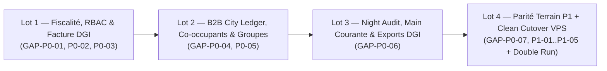

# Audit Fonctionnel & Technique — Flex PMS 9 vs MakarimPMS_V2
## 04. Analyse d'Écarts (Gap Analysis) & Plan d'Alignement Avant Go-Live VPS

**Date d'audit :** 18/11/2026  
**Comparaison croisée :**
- **Référentiel terrain (Legacy en production) :** Audit complet Flex PMS 9 (`docs_audit/01`, `02`, `03`) + 26 exports réels 2025–2026 de l'Hôtel Makarim Tétouan.
- **Codebase cible inspectée :** Branche `origin/main` de `MakarimPMS_V2` (**NestJS + Prisma + MySQL 8 + React/Vite/Tailwind/shadcn**, 21 modules backend, 61 composants/pages frontend, déployé sur **VPS Hostinger KVM 2 `pms.hotelmakarim.ma`**).
- **Décisions d'arbitrage intégrées :** Session de cadrage `/grill-me` validée le 18/11/2026 (Clean Cutover, P0 Fiscalité + B2B/Groupes/Co-occupants + Night Audit/Main Courante/Export DGI, Saisie rapide extras restaurant Phase 1).

---

## 1. Synthèse exécutive — Verdict de préparation au Go-Live

`MakarimPMS_V2` (`origin/main`) dispose d'une **base technique et sécuritaire largement supérieure** à Flex PMS 9 (architecture 3-tiers, authentification JWT + rotation refresh token, chiffrement AES-256-GCM des pièces d'identité, `AuditLog` transactionnel, soft delete global, Booking Engine, Channel Manager Booking/Airbnb, Self Check-in QR, OCR passeport/CIN, Notifications Email/SMS/WhatsApp, Maintenance, Stock ménager, RH/Paie CNSS, Yield Management).

**En revanche, la bascule en production en l'état est impossible** en raison de **7 écarts bloquants (P0)** prouvés par la lecture du code source de `origin/main` face à la réalité quotidienne de l'Hôtel Makarim :

| Catégorie | Nb | Constat synthétique |
| :--- | :---: | :--- |
| **Domaines où V2 surpasse déjà Flex PMS 9** | 11 | Sécurité/Auth/Chiffrement, Audit immuable, Booking Engine, Channel Manager, Self Check-in, OCR, Maintenance, Stock, RH/CNSS, Yield, Notifications. |
| **Écarts bloquants Go-Live (P0)** | **7** | (1) RBAC Réception bloque encaissement/facturation au comptoir, (2) Fiscalité (`nbPersonnes = capacite`, pas de `RESTAURATION 10%`, `TAXE_SEJOUR = 3` au lieu de `4,30`), (3) `InvoicePrintModal.tsx` (données légales factices `12345` en dur + TVA 20 % en dur + sans HT/TVA/ICE client/arrêté en lettres), (4) `Company` déconnectée (alors que 35–68 % des factures Makarim sont B2B avec ICE), (5) 1 seul `PoliceRecord` par `Stay` + absence de Dossiers Groupes / Master Folio / Transfert lignes, (6) Absence de Night Audit / Main Courante / Contrôle Caisse / Export comptable DGI / Préparation Restaurant, (7) Seed/Config non conformes au parc réel Makarim (`401–502` fictifs vs `101–308` réels). |
| **Écarts opérationnels importants (P1)** | **6** | Délogement (`transfer-room`), Prolongation séjour (`extend`), Verrouillage de chambre (`lockedRoom`), Saisie rapide extras multi-chambres (`RESTAURANT`), Vue Floor Planning par étage, UI dédiée aux Avoirs (`CreditNote`) et Lost & Found. |

---

## 2. Matrice comparative exhaustive — Flex PMS 9 vs `MakarimPMS_V2` (`origin/main`)

| Domaine / Fonctionnalité | Réalité Flex PMS 9 (Prod Makarim) | État réel dans `origin/main` (Preuve code) | Statut | Priorité |
| :--- | :--- | :--- | :---: | :---: |
| **Parc chambres & Config légale** | 25 chambres (24 actives) sur 3 étages `101–108`, `201–208`, `301–308` · Types `DBL`/`DBL Vue Montagne`/`TWN`/`TRP`/`TRP Vue Montagne`/`QDR` · `RC 25149`, `ICE 002270052000083`, `CNSS 1322850` | `seed.ts` L192–198 : chambres `101..106`, `201..208`, `301..304`, **`401..404`, `501..502`** (sans `Twins` ni vues) ; `hotelConfig` à `000000000000000` (L377–386) sans champs `cnss`/`patente`/`telephone`/`fax`/`email`. | ❌ Écart majeur | **P0** |
| **RBAC Réception / Caisse** | Les réceptionnistes encaissent (`ESP`/`CC`) et facturent 24h/24 (8 comptes actifs sur 100 % des factures individuelles 2025–2026) | `seed.ts` L462–491 & `RBAC_MATRIX.md` L78 : `Réception` a `payments:read` seul (pas `payments:write`) et **aucun droit `billing`**. Combiné au blocage check-out sur solde positif (`CH-005`), **un réceptionniste ne peut ni encaisser ni facturer ni faire le check-out**. | ❌ Bloquant prod | **P0** |
| **Calcul taxes (`TPT+TS`) & PDJ par pax** | `TPT+TS = 4,30 MAD/pax/nuit`, `PD = 45 MAD/pax/nuit` calculés sur le nombre **réel** d'adultes (`NBR_PAX_RL`) | `billing.service.ts` L174 & `invoice-calc.ts` L45 : **`nbPersonnes = roomType.capacite`** (aucun champ `nbAdultes`/`nbEnfants` sur `Reservation`/`Stay`) ; `seed.ts` L235 : `TAXE_SEJOUR = 3 MAD`, `PD = 50 MAD`. Surfacture toute occupation simple en Double/Triple/Quadruple. | ❌ Erreur calcul | **P0** |
| **TVA Restauration (10 %) vs Extras (20 %)** | Hébergement, Petit-déjeuner (`PD`) et Restaurant (`REST`) tous taxés à **10 % TVA** | `schema.prisma` (`TypeLigneFolio`) n'a que `HEBERGEMENT` (10 %), `EXTRA` (20 %) et `TAXE_SEJOUR` (0 %). `InvoicePrintModal.tsx` L208–211 applique **20 % en dur** sur `RESTAURATION`. | ❌ Erreur fiscale | **P0** |
| **Impression Facture (DGI Maroc)** | En-tête Makarim, ICE client, détail HT/TVA/TPT+TS/TTC, mode règlement, arrêté en toutes lettres MAD, numérotation `NNN/AA` | `InvoicePrintModal.tsx` : pied légal codé en dur (`ICE: 123456789012345`, `RC: 12345`, tél. Rabat `+212 5 37...`), pas de détail HT/TVA/Taxes, pas de filtrage `!l.annulee`, pas d'ICE client, pas d'arrêté en lettres ; `generateInvoiceNumber` figé sur `FAC-YYYYMM-000001`. | ❌ Non conforme | **P0** |
| **Avoirs (`CreditNote`)** | Déductions motivées / corrections | Backend `POST /invoices/:id/credit-notes` OK (`CH-001`), mais **aucune interface frontend** (`statut_modules.md` L18 : `pas d'UI pour l'avoir`). | ⚠️ UI absente | **P0** |
| **Clients B2B / City Ledger (`Company`)** | **35 % à 68 %** des factures mensuelles portent un ICE société (`ECOMED`, `SOMAPRED`, `AGMA`, agences) ; factures mensuelles consolidées | `schema.prisma` : `Company` n'a **aucune FK** vers `Reservation`/`Stay`/`Folio`/`Invoice` (`CH-021` fermé en `EA-001` avant audit terrain). | ❌ Manquant critique | **P0** |
| **Co-occupants & Fiche de police** | Multi-occupants (`F_OCINFO` : conjoint, adultes, enfants, CIN/Passeport par personne) | `schema.prisma` : `Stay.policeRecord PoliceRecord?` (**relation 1-to-1 unique**). Impossible d'enregistrer un 2e/3e/4e occupant légalement. | ❌ Non conforme DGSN | **P0** |
| **Groupes, Rooming list & Master Folio** | `F_RSV` → `F_PRL` → `F_RML`, attribution en masse, check-in/out bloc, transfert de lignes entre chambres/master, facture groupe nominative avec CIN (`Province Tétouan`) | **Absent** : `Reservation` mono-chambre uniquement ; `Folio` 1:N en base mais 1 seul folio principal créé (`incompletes.md` L14), aucun endpoint de création de folio secondaire ni de transfert de ligne. | ❌ Manquant critique | **P0** |
| **Night Audit & Main Courante** | `FEN_END_OF_DAY`, table `CLOTURE`, verrouillage `CLOTURE_JV = 1`, `ETAT_MAIN_COURANTE`, `ETAT_JNL_TRESO_GRP_MODE` | **Absent** : aucun modèle `DailyClosure`, pas de date hôtel comptable, pas de Main Courante ni de contrôle caisse par shift/mode de règlement. | ❌ Manquant critique | **P0** |
| **Export comptable mensuel DGI** | Retraitement Excel manuel (`Num`, `Date`, `HT`, `TVA`, `TTC`, `Client`, `ICE`, `Mode de paiement`) | `financial-reporting.service.ts` L47–76 : `exportGrandLivre` n'exporte que `date, folioId, sejourId, type, libelle, montantHT, annulee` (sans facture, TVA, TTC, ICE, ni mode de paiement). | ❌ Insuffisant | **P0** |
| **Préparation Restaurant** | `ETAT_Restaurant` : couverts PDJ / Déj / Dîner prévus demain | **Absent** de `operational-reporting.service.ts`. | ❌ Manquant | **P0** |
| **Délogement / Prolongation / Verrouillage** | `FEN_DELOG`, prolongation séjour, cadenas `Verrouiller` (`A NE PAS DLG`) | `stay.controller.ts` a `shorten` (écourter), mais **ni `transfer-room` (délogement), ni `extend` (prolongation), ni verrouillage anti-délogement**. | ⚠️ Partiel | **P1** |
| **Saisie rapide extras restaurant (Phase 1 POS)** | `FEN_SAISIE_TRANSACTION` + flux `COM_TICKET_TO_PMS.fic` | `FolioLine` a déjà `sourceModule` et `sourceRef` en base, mais pas d'écran dédié de saisie rapide multi-chambres. | ⚠️ UI à créer | **P1** |
| **Housekeeping, Floor Planning & Lost & Found** | `FEN_FloorPlanning` (cartes par étage), `FEN_Table_F_LOSTFOUND`, chambres hors vente | `HousekeepingPage.tsx` + `RoomStatusLog` + `MaintenanceTicket` présents ; manquent **vue Floor Planning visuelle** et registre **Lost & Found**. | ⚠️ Partiel | **P1** |
| **Visual Planning & Réservations individuelles** | `FEN_VISUEL_PLANNING` + tableau dispo par type | `ReservationsCalendarPage.tsx`, `RoomNight`, `SeasonRate`, `RateRestriction`, `CancellationPolicy`, `ReservationDeposit` implémentés. | ✅ Couvert | — |
| **Sécurité, Audit, OCR, Self-Checkin, Channel Manager, RH, Stock** | Absents ou très faibles dans Flex PMS 9 | Implémentés et audités dans `origin/main` (21 modules). | ✅ Supérieur V2 | — |

---

## 3. Spécification détaillée des 7 chantiers bloquants (P0)

### GAP-P0-01 — Réalignement de la matrice RBAC Réception / Caisse (`seed.ts` & `RBAC_MATRIX.md`)
- **Constat code (`origin/main`) :** Dans `backend/prisma/seed.ts` (L462–491), `Réception` ne possède ni `billing:read`, ni `billing:write`, ni `payments:write`. Or `StayService.checkout()` (`CH-005`) refuse tout check-out tant que le solde du folio est > 0 MAD.
- **Correction cible :**
  - Accorder au rôle **`Réception`** : `billing:read`, `billing:write` (ajout lignes extras/restauration, création folios secondaires, génération facture), `payments:read`, `payments:write` (encaissement `ESP`/`CC`/`CHQ`/`VIR`), `reporting:read` (limité aux états opérationnels du jour : arrivées/départs, contrôle caisse de son shift, préparation restaurant).
  - Créer des **permissions fines réservées au Superviseur / Comptable / Admin** (pattern déjà établi par `payments:refund` et `checkin:force-checkout`) :
    - `billing:credit-note` → **Comptable + Admin** uniquement (émission d'avoirs).
    - `billing:cancel-line` → **Réception** (sur journée ouverte uniquement, motif obligatoire ≥ 10 car., journalisé `AuditLog`) ; **bloqué après Night Audit**.
    - `billing:consolidate-company` → **Comptable + Admin** (facturation mensuelle City Ledger).
    - `night-audit:execute` → **Night Auditor / Chef de Réception / Admin**.
  - Ajouter le rôle **`Night Auditor`** (ou **`Chef de Réception`**) dans `seed.ts` et `docs/RBAC_MATRIX.md`.

---

### GAP-P0-02 — Moteur fiscal marocain exact & Capacité réelle (`nbAdultes` / `nbEnfants`)
- **Constat code (`origin/main`) :**
  1. `billing.service.ts` L174 & `pricing.ts` utilisent `roomType.capacite` au lieu du nombre réel d'occupants.
  2. `TypeLigneFolio` (`schema.prisma`) ne contient pas `RESTAURATION`.
  3. `seed.ts` L235 paramètre `TAXE_SEJOUR = 3` (au lieu de `4,30 MAD` ou décomposé `TS` + `TPT` = `4,30 MAD` hors TVA).
  4. `generateInvoiceNumber()` (`invoice-calc.ts` L64) fige le format `FAC-YYYYMM-000001`.
- **Modifications Prisma & Backend :**
  - **Prisma (`Reservation` & `Stay`) :** ajouter `nbAdultes Int @default(1)` et `nbEnfants Int @default(0)` (avec contrainte applicative `nbAdultes >= 1`, avertissement si `nbAdultes + nbEnfants > roomType.capacite` reprenant la règle métier des 3 options de Flex PMS).
  - **Prisma (`TypeLigneFolio`) :** ajouter `RESTAURATION` ; ajouter `TVA_RESTAURATION` (`10 %`) dans `TaxRateConfig`.
  - **`invoice-calc.ts` :**
    - `HEBERGEMENT` → `TVA_HEBERGEMENT` (10 %)
    - `RESTAURATION` → `TVA_RESTAURATION` (10 %) *(petits-déjeuners, demi-pension, pension complète, tickets restaurant)*
    - `EXTRA` → `TVA_ANNEXE` (20 %, ou taux spécifique par ligne `FolioLine.tauxTva` si renseigné)
    - `TAXE_SEJOUR` (`TS` + `TPT`) → **0 % TVA (hors champ TVA)**, calculé sur `nights × stay.nbAdultes` (les enfants n'étant pas assujettis).
    - Exposer un retour structuré `{ totalHt, totalTva10, totalTva20, totalTaxesSejour, totalTtc }` (et stocker `totalHt`, `totalTva`, `totalTaxes` sur `Invoice` pour éviter tout recalcul divergent côté frontend !).
  - **Numérotation fiscale (`HotelConfig` + `Invoice`) :** ajouter `invoiceNumberFormat` (`ANNUEL_COURT` → `001/26` ou `COMPLET` → `FAC-2026-000001`) + compteur atomique annuel `InvoiceSequence` en transaction MySQL (zéro doublon, zéro trou non justifié).

---

### GAP-P0-03 — Refonte de `InvoicePrintModal.tsx` & UI des Avoirs (`CreditNote`)
- **Constat code (`origin/main`) :** `InvoicePrintModal.tsx` contient des valeurs fictives codées en dur (`ICE: 123456789012345`, `RC: 12345`, `Rabat`, `+212 5 37 00 00 00`, TVA `* 1.2` sur `RESTAURATION`), imprime les lignes annulées et n'affiche ni la ventilation HT/TVA/Taxes ni l'arrêté en toutes lettres.
- **Correction cible :**
  - Enrichir **`HotelConfig`** (Prisma + `ParametersPage.tsx`) avec : `cnss`, `patente`, `telephone`, `fax`, `email`, `siteWeb`, `logoUrl`, `invoiceNumberFormat`.
  - Supprimer **100 % des calculs TVA du frontend** : `GET /invoices/:id` renvoie la ventilation fiscale exacte figée en base (`totalHt`, `totalTva10`, `totalTva20`, `totalTaxes`, `montantTotal`, `montantEnLettres`, `modesPaiement[]`, `printCount`, `isDuplicate`).
  - Filtrer `!l.annulee`, afficher le bloc client **ou société (`company.raisonSociale`, `company.ice`, `company.adresse`)**, les dates de séjour (`du ... au ...`), `Nbr nuitées`, `Nbr PAX`, le tableau `HT / TVA / TTC`, le détail `TOTAL TAXES (TPT+TS)`, `TOTAL HT`, `TOTAL TVA`, `TOTAL TTC`, le mode de règlement, l'arrêté en toutes lettres en Dirhams (*« Arrêtée la présente facture à la somme de … DIRHAMS »*), la mention **`DUPLICATA`** dès la 2e impression (`printCount > 1`), et le pied légal lu depuis `HotelConfig`.
  - Ajouter les **3 présentations** issues de Flex PMS : *Facture détaillée*, *Facture synthétique* (`HEBERGEMENT / REPAS / TAXES`), et *Note pro-forma* (relevé sans numéro fiscal).
  - Ajouter le **bouton & dialogue d'émission d'Avoir** (`POST /invoices/:id/credit-notes` avec motif obligatoire) dans `BillingPage.tsx` / `BillingTabContent.tsx`.

---

### GAP-P0-04 — Connexion complète `Company` / City Ledger & Facturation mensuelle consolidée
- **Constat code (`origin/main`) :** `Company` est isolée (`CH-021` dépriorisé). En production Makarim, `CL00014` (ECOMED), `CL00023` (SOMAPRED), `CL00033` (Colchique Voyage), `SALIPRO`, `AGMA`, `IMETAL` représentent jusqu'à **68 % des factures mensuelles**.
- **Modifications Prisma & Backend :**
  - Enrichir `Company` : `adresse`, `ville`, `telephone`, `email`, `typeTiers` (`SOCIETE | AGENCE | TO | OTA | ADMINISTRATION`), contrôle strict **`ice` sur 15 chiffres** (regex `/^\d{15}$/`).
  - Ajouter `companyId Int?` (FK → `Company`) sur **`Reservation`**, **`Folio`** et **`Invoice`** (avec `codeCompte` optionnel ex. `CL00014` pour traçabilité migration).
  - Implémenter le **contrôle `plafondCredit`** et le statut **`EN_COMPTE` (City Ledger)** : un folio affecté à une `Company` active sous plafond peut passer au check-out avec transfert en compte débiteur (sans bloquer sur paiement espèces/CB immédiat).
  - Ajouter **`POST /companies/:id/consolidated-invoices`** : sélection de plusieurs séjours/folios d'une période (ex. ECOMED du 01/01 au 31/01) → génération d'une **Facture Globale consolidée** (`Invoice` liée à `companyId` + table de jonction `InvoiceFolio`) avec suivi du solde débiteur dans `CompaniesPage.tsx` (Grand Livre & Balance âgée 30/60/90j).

---

### GAP-P0-05 — Co-occupants (`PoliceRecord` 1-to-N), Dossiers Groupes & Multi-Folios / Transferts
- **Constat code (`origin/main`) :** `Stay.policeRecord` est 1-to-1 ; `Folio` 1:N n'est jamais exploité au-delà du folio principal ; aucun dossier Groupe n'existe.
- **Modifications Prisma & Backend :**
  1. **Co-occupants (`Stay` 1-to-N `StayGuest` / `PoliceRecord`) :**
     - Retirer `@unique` sur `PoliceRecord.stayId` → `Stay.policeRecords PoliceRecord[]` + ajouter `estPrincipal Boolean @default(false)` et `typeOccupant` (`ADULTE | ENFANT`).
     - Mettre à jour l'onglet Police de `StayDetailsDialog.tsx` pour saisir et imprimer **tous les occupants d'une chambre** (couple, famille, techniciens) et alimenter le registre DGSN complet.
  2. **Multi-Folios opérationnels & Transferts (`BillingController`) :**
     - `POST /stays/:stayId/folios` : créer jusqu'à 5 folios par séjour (ex. `Folio 1 — Hébergement Société`, `Folio 2 — Extras Client`), avec `companyId` optionnel par folio.
     - `POST /folios/:folioId/lignes/:lineId/transfer` : transférer une ou plusieurs lignes non facturées vers un autre folio du même séjour, vers une autre chambre présente, ou vers un **Master Folio Groupe** (avec `AuditLog` transactionnel).
  3. **Module Dossier Groupe (`GroupBooking`) :**
     - Nouveau modèle **`GroupBooking`** (`code`, `nomGroupe`, `companyId`, `dateArrivee`, `dateDepart`, `statut`, `masterFolioId`, `centralisationExtras` : `GLOBALE | PAR_CHAMBRE`, `notes`) lié en `1:N` à **`Reservation`** (`groupBookingId Int?`) + modèle **`GroupAllocation`** (pré-rooming par `roomTypeId`, `nbChambres`, `nbAdultesParChambre`, `formule`).
     - Endpoints : `POST /groups` (création + contrôle strict dispo par type), `POST /groups/:id/assign-rooms` (attribution en masse multi-chambres), `POST /groups/:id/checkin` (check-in en bloc), `POST /groups/:id/checkout` (check-out en bloc avec exclusion sélective de chambres), et **modèle d'impression Facture Groupe nominative** (tableau `Nom & Prénom | Ville | CIN | N° Chambre | Dates | PU | Nuitées | Total`, reproduisant `facture province Tétouan.rtf` nativement !).

---

### GAP-P0-06 — Night Audit ACID, Main Courante, Contrôle Caisse, Export DGI & Préparation Restaurant
- **Constat code (`origin/main`) :** Aucun `DailyClosure`, aucune Main Courante, aucun contrôle caisse par mode, aucun export DGI avec ICE + modes de paiement, aucun état Préparation Restaurant.
- **Modifications Prisma & Backend :**
  1. **Modèle `DailyClosure` (Night Audit) & `HotelConfig.currentBusinessDate` :**
     - Champs : `businessDate DateTime @unique`, `closedByUserId`, `closedAt`, `totalRooms`, `activeRooms`, `blockedRooms`, `soldRooms`, `occupancyRate`, `openingBalance`, `dailyRevenueTtc`, `dailyPaymentsTotal`, `cityLedgerTransfers`, `closingBalance`, `noShowsCount`, `snapshotJson`.
     - **Workflow transactionnel ACID (`POST /night-audit/close`, idempotent par `businessDate`) :**
       1. Pré-contrôles (`GET /night-audit/preflight`) : arrivées du jour non check-in (action : reporter ou basculer `NO_SHOW`), départs prévus non clôturés (action : prolonger ou check-out), folios en anomalie.
       2. Verrouillage des `FolioLine` et `Payment` du jour (`closedInAuditId`).
       3. Calcul et persistance de l'équilibre Main Courante (`Solde Veille + CA TTC Jour - Encaissements - Transferts City Ledger = Solde Fin Jour`) et des KPIs d'occupation (remplaçant `F_SYT1`).
       4. Bascule atomique `HotelConfig.currentBusinessDate` (`J → J+1`).
  2. **Nouveaux endpoints dans `ReportingController` :**
     - `GET /reporting/main-courante?date=YYYY-MM-DD` (JSON + PDF) : équilibre journalier complet + ventilation par service et chambre.
     - `GET /reporting/cash-control?dateDebut=...&dateFin=...` (JSON + PDF) : contrôle de caisse réception ventilé par `MoyenPaiement` (`ESPECES`, `CARTE_BANCAIRE`, `CHEQUE`, `VIREMENT`) et par caissier/shift.
     - **`GET /reporting/accounting-export?dateDebut=...&dateFin=...&format=xlsx|csv`** : export comptable mensuel DGI natif remplaçant le retraitement manuel `Table REQ_DOC ...xls` :
       `Numéro | Type (Facture/Avoir) | Date | Total HT | TVA 10% | TVA 20% | TPT+TS (0%) | Total TTC | Client / Société | ICE (15 chiffres) | Mode(s) de règlement ventilés | Statut | N° Réservation | Chambres`.
     - `GET /reporting/restaurant-forecast?date=YYYY-MM-DD` : état Préparation Restaurant (nombre de `PDJ`, `Déjeuners`, `Dîners` prévus par chambre, occupant et formule `BB`/`DP`/`PC`).

---

### GAP-P0-07 — Paramétrage réel Hôtel Makarim & Script de Seed de Production (`seed-makarim-prod.ts`)
- **Constat code (`origin/main`) :** `seed.ts` est un seed destructif de démo contenant des chambres `401–502` inexistantes, des prix/taxes approximatifs (`3 MAD`, `50 MAD`) et des coordonnées légales à zéro.
- **Correction cible :**
  - Créer un script **non destructif et idempotent** (`backend/prisma/seed-makarim-prod.ts`) dédié au **Clean Cutover** de l'Hôtel Makarim :
    - **`HotelConfig` :** `Hôtel Makarim`, `Bd. Al-Okhouane, Quartier AL WIQAYA, BP. 93020, Tétouan, Maroc`, `RC: 25149`, `ICE: 002270052000083`, `CNSS: 1322850`, `Tél: +212 808 533 621`, `Fax: +212 808 546 005`, `Email: contact@hotel-makarim-tetouan.com`.
    - **Chambres réelles :** **25 chambres** sur 3 étages (`101–108`, `201–208`, `301–308` + 1 chambre technique/bloquée → 24 actives), typologies réelles (`DOUBLE`, `DOUBLE VUE MONTAGNE`, `TWINS`, `TRIPLE`, `TRIPLE VUE MONTAGNE`, `QUADRUPLE`) avec vues et tarifs 2026 validés.
    - **Fiscalité réelle :** `TVA_HEBERGEMENT = 10%`, `TVA_RESTAURATION = 10%`, `TVA_ANNEXE = 20%`, `TPT_TS = 4,30 MAD` (`MONTANT_FIXE`, `collectePourTresor = true`, hors TVA), `prixPetitDejeuner = 45 MAD`.
    - **Comptes sociétés B2B & équipe :** import propre depuis CSV extrait de `HOTEL_DATA` (sociétés récurrentes avec ICE validé + comptes utilisateurs nominatifs avec mots de passe forts obligatoirement changés à la première connexion).

---

## 4. Écarts P1 (Parité opérationnelle réception & gouvernante)

| ID | Fonctionnalité | Implémentation ciblée dans `MakarimPMS_V2` |
| :---: | :--- | :--- |
| **GAP-P1-01** | **Délogement (`FEN_DELOG`)** | `PATCH /stays/:id/transfer-room` (changement de chambre sur nuits restantes, libération anciennes `RoomNight` + création nouvelles, passage ancienne chambre `A_NETTOYER`, conservation folios, `AuditLog` + motif). |
| **GAP-P1-02** | **Prolongation de séjour** | `PATCH /stays/:id/extend` (symétrique de `shortenStay` existant : contrôle dispo sur nouvelles nuits, ajout `RoomNight` + lignes hébergement au tarif saisonnier actif). |
| **GAP-P1-03** | **Verrouillage de chambre (`A NE PAS DLG`)** | Champ `roomLocked Boolean @default(false)` sur `Reservation`/`Stay` + icône cadenas sur le calendrier ; bloque le délogement sauf permission Superviseur. |
| **GAP-P1-04** | **Saisie rapide extras / restaurant (Phase 1 POS)** | Écran/modale *Saisie rapide* (sélection multi-chambres, catalogue prestations prédéfinies `REST`/`PD`/`LBB`/`MINIBAR`, `sourceModule='RESTAURANT'`, `sourceRef=N° ticket`, type `RESTAURATION 10%` ou `EXTRA 20%`). |
| **GAP-P1-05** | **Floor Planning par étage & Lost & Found** | Vue par étage (`1`, `2`, `3`) avec cartes chambres (statut occupation + ménage + accès direct Séjour/Extras) dans `HousekeepingPage` + modèle léger `LostAndFoundItem`. |
| **GAP-P1-06** | **Reprise d'archives & Gouvernance docs** | Mettre à jour `docs/governance/ECARTS_ASSUMES.md` (réouverture officielle de `CH-021` / `EA-001` suite à l'audit prod Makarim) et `docs/RBAC_MATRIX.md`. |

---

## 5. Plan d'exécution recommandé par lots (jusqu'au Go-Live VPS)

### Lot 1 — Correctifs Fiscaux, RBAC Réception & Impression Facture (Fondation critique)
- **Migrations Prisma :** `nbAdultes`/`nbEnfants` sur `Reservation`/`Stay`, `TypeLigneFolio.RESTAURATION`, champs légaux + `invoiceNumberFormat` sur `HotelConfig`, colonnes `totalHt`/`totalTva`/`totalTaxes`/`printCount` sur `Invoice`, séquence annuelle `InvoiceSequence`.
- **Backend :** refonte `invoice-calc.ts`, `billing.service.ts`, `reservations/utils/pricing.ts`, mise à jour `seed.ts` (RBAC `Réception` + `billing:credit-note` + `night-audit:execute`).
- **Frontend :** refonte complète `InvoicePrintModal.tsx` (données `HotelConfig`, zéro hardcoding, ventilation HT/TVA/TPT+TS, ICE client, arrêté en lettres MAD, mention `DUPLICATA`, 3 formats) + UI **Créer un Avoir** dans `BillingPage.tsx`.
- **Critère de sortie (DoD) :** tests unitaires & e2e MySQL verts sur une facture `450 MAD` (1 adulte, BB) prouvant `TPT+TS = 4,30 MAD` à `0 % TVA`, `RESTAURATION` à `10 % TVA`, et check-out complet réalisable par un compte `Réception`.

### Lot 2 — B2B City Ledger (`Company`), Co-occupants & Dossiers Groupes
- **Migrations Prisma :** FK `companyId` sur `Reservation`/`Folio`/`Invoice`, `PoliceRecord` en `1:N` sur `Stay`, tables `GroupBooking`, `GroupAllocation`, `InvoiceFolio`.
- **Backend :** `POST /stays/:stayId/folios`, `POST /folios/:id/lignes/:lineId/transfer`, `POST /companies/:id/consolidated-invoices`, module `groups` (création, pré-rooming, attribution en masse, check-in/out bloc).
- **Frontend :** sélecteur `Company` + ICE sur réservation/folio, multi-occupants dans l'onglet Police de `StayDetailsDialog`, gestion multi-folios & transferts, page `GroupsPage.tsx` + modèle d'impression **Facture Groupe nominative avec CIN**.
- **Critère de sortie (DoD) :** scénario e2e complet reproduisant (1) la facturation mensuelle consolidée `ECOMED` et (2) un dossier groupe 4 chambres avec facture nominative multi-CIN (`Province Tétouan`).

### Lot 3 — Night Audit ACID, Main Courante & Exports Comptables DGI
- **Migrations Prisma :** `DailyClosure`, `HotelConfig.currentBusinessDate`, `FolioLine.closedInAuditId` / `Payment.closedInAuditId`.
- **Backend :** module `night-audit` (`preflight`, `close` ACID idempotent, verrouillage post-clôture) + 4 endpoints dans `reporting` (`main-courante`, `cash-control`, `accounting-export` Excel/CSV DGI avec ICE & modes ventilés, `restaurant-forecast`).
- **Frontend :** page `NightAuditPage.tsx` (assistant 3 étapes pré-clôture → validation → dossier Main Courante), onglets *Contrôle Caisse*, *Export TVA/ICE* et *Préparation Restaurant* dans `ReportingPage.tsx`.
- **Critère de sortie (DoD) :** équation Main Courante équilibrée au centime près, double appel `POST /night-audit/close` strictement idempotent, export Excel mensuel directement exploitable par le comptable sans retouche manuelle.

### Lot 4 — Parité Terrain (P1), Clean Cutover & Mise en Production VPS
- **Fonctionnalités P1 :** Délogement (`transfer-room`), Prolongation (`extend`), `roomLocked`, Saisie rapide extras restaurant multi-chambres (`sourceModule='RESTAURANT'`), vue Floor Planning par étage, Lost & Found.
- **Préparation Clean Cutover (`seed-makarim-prod.ts` + script d'import CSV) :**
  1. Exporter depuis `HOTEL_DATA` (lecture seule) les 4 fichiers propres : `chambres_25.csv`, `societes_ice.csv`, `reservations_futures.csv`, `soldes_debiteurs_ouverts.csv`.
  2. Déployer sur `pms.hotelmakarim.ma` via pipeline CI/CD (`deploy.yml` + contrôle `GET /api/health` + test de restauration `mysqldump`).
  3. Mener **7 à 14 jours de double run** (comparaison quotidienne de la Main Courante, du contrôle caisse `ESP`/`CC` et du taux d'occupation entre Flex PMS 9 et `MakarimPMS_V2`).
  4. Bascule officielle en début de mois (ex. 1er du mois), Flex PMS 9 restant accessible en **lecture seule** pour consultation des archives 2018–2026.
