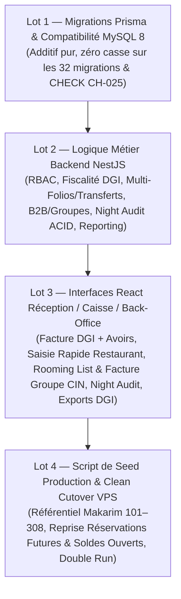

# Audit Fonctionnel & Technique — Flex PMS 9 vs MakarimPMS_V2
## 04. Analyse d'Écarts (Gap Analysis) & Plan d'Implémentation P0 Avant Go-Live VPS

**Date d'audit :** 18/11/2026  
**Comparaison croisée :**
- **Référentiel terrain (Legacy en production) :** Audit complet Flex PMS 9 (`docs_audit/01`, `02`, `03`) + 26 exports réels 2025–2026 de l'Hôtel Makarim Tétouan (`HOTEL_DATA`, 25 chambres / 24 actives).
- **Codebase cible inspectée :** Branche `origin/main` de `MakarimPMS_V2` (**NestJS + Prisma + MySQL 8 + React/Vite/Tailwind/shadcn**, 32 migrations Prisma jusqu'à `20260724063000_ch025_check_constraints`, 21 modules backend, 17 features frontend, déployé sur **VPS Hostinger KVM 2 `pms.hotelmakarim.ma`**).
- **Cadrage validé (`/grill-me`, 18/11/2026) :** Clean Cutover (Flex PMS 9 conservé en lecture seule pour archives 2018–2026), exécution intégrale des **7 axes P0** avant bascule, Phase 1 POS par saisie rapide restaurant intégrée (`sourceModule='RESTAURANT'`).

---

## 1. Synthèse exécutive — Verdict de préparation au Go-Live

`MakarimPMS_V2` (`origin/main`) dispose d'une **base technique et sécuritaire nettement supérieure** à Flex PMS 9 : architecture 3-tiers, authentification JWT avec rotation de `RefreshToken`, chiffrement AES-256-GCM des numéros de pièce d'identité (`pieceIdentiteHash`), `AuditLog` transactionnel, soft delete global (`deletedAt`), contraintes `CHECK` natives MySQL 8 (`CH-025`), Booking Engine public, Channel Manager OTA, Self Check-in QR, OCR passeport/CIN, Notifications Email/SMS/WhatsApp, Maintenance, Stock, RH/Paie CNSS et Yield Management.

**Toutefois, la mise en production en l'état est bloquée** par **7 axes d'écarts P0** (dont **3 bugs de calcul/concurrence découverts directement dans le code source de facturation** de `origin/main`) :

| Axe | Domaine critique Makarim | État `origin/main` | Impact Go-Live |
| :---: | :--- | :--- | :--- |
| **Axe 1** | **RBAC Réception / Caisse / Night Audit** | `Réception` n'a que `payments:read` et **0 droit `billing`** (`seed.ts` L462–491) | ❌ Blocage total du check-out et de l'encaissement au comptoir (`CH-005`) |
| **Axe 2** | **Moteur fiscal DGI Maroc & `nbAdultes`/`nbEnfants`** | Proxy `roomType.capacite` ; `TAXE_SEJOUR = 3` (vs `4,30 MAD`), `PD = 50` (vs `45 MAD`) ; **bug critique `RESTAURATION`** (0 % dans `invoice-calc.ts`, 20 % dans `solde.ts` & UI, alors que TVA Maroc = **10 %**) ; **bug critique `PAIEMENT`** non exclu dans `calculateInvoiceTotal()` ; collision `generateInvoiceNumber(0)` | ❌ Factures fausses, surfacturation en occupation simple, risque de collision concurrente |
| **Axe 3** | **Impression Facture DGI & UI Avoirs (`CreditNote`)** | `InvoicePrintModal.tsx` a un pied légal factice en dur (`ICE: 123456789012345`, `RC: 12345`, Rabat `+212 5 37...`), TVA `* 1.2` en dur, pas de filtre `!l.annulee`, pas d'ICE client ni arrêté en lettres ; aucune UI frontend pour `CreditNote` | ❌ Factures illégales fiscalement au Maroc ; avoirs inutilisables côté UI |
| **Axe 4** | **Clients B2B / City Ledger (`Company`)** | `Company` isolée sans FK vers `Reservation`/`Folio`/`Invoice` (`CH-021` fermé prématurément) ; `MoyenPaiement` sans `CHEQUE` | ❌ Impossible de facturer les **35 %–68 %** de CA B2B Makarim (`ECOMED`, `SOMAPRED`, agences) |
| **Axe 5** | **Co-occupants (`PoliceRecord` 1-to-N), Groupes & Multi-Folios** | `Stay.policeRecord` en **1-to-1** (`stayId @unique`) ; 1 seul folio principal créé, aucun transfert de ligne ; aucun module Dossier Groupe / Rooming list / Master Folio | ❌ Non-conformité registre DGSN (couples/familles) et blocage groupes / administrations (`Province Tétouan`) |
| **Axe 6** | **Night Audit ACID, Main Courante, Contrôle Caisse, Export DGI & Restaurant** | Aucun `DailyClosure`, pas de date hôtel comptable, pas de Main Courante ni Contrôle Caisse, `exportGrandLivre` sans ICE/TVA/TTC/mode de paiement, pas de Préparation Restaurant | ❌ Impossible de clôturer la journée, contrôler la caisse ou produire l'export TVA/ICE mensuel sans retraitement Excel |
| **Axe 7** | **Référentiel réel Makarim & Clean Cutover** | `seed.ts` destructif de démo (`401–502` fictifs, `HotelConfig` à `000000000000000`, sans `cnss`/`patente`/`telephone`/`fax`/`email`) | ❌ Données de référence inutilisables en production |

---

## 2. Analyse précise des écarts par couche technique (`origin/main` vs 7 axes validés)

### 2.1 Couche Données — Schéma Prisma (`backend/prisma/schema.prisma`) & 32 migrations existantes

L'historique des migrations se termine sur `20260724063000_ch025_check_constraints/migration.sql`, qui porte **4 contraintes `CHECK` natives MySQL 8** hors schéma Prisma (`chk_reservation_dates`, `chk_payment_montant_positif`, `chk_folioline_montant_positif` (`montant >= 0`), `chk_timeshiftsegment_fin_apres_debut`). **Toute migration future doit être strictement additive (`ALTER TABLE`) sans jamais `DROP/CREATE` ces 4 tables.**

| Axe | Modèle / Enum actuel (`schema.prisma`) | Écart précis constaté dans `origin/main` | Evolution cible (Lot 1) |
| :---: | :--- | :--- | :--- |
| **Axe 2** | `Reservation` (L272), `Stay` (L401) | Aucun champ `nbAdultes` ni `nbEnfants` → tout le moteur tarifaire et fiscal utilise `RoomType.capacite`. | Ajouter `nbAdultes Int @default(1)` et `nbEnfants Int @default(0)` sur `Reservation` et `Stay` (+ `roomLocked Boolean @default(false)` pour P1). |
| **Axe 2** | `TypeLigneFolio` (L464), `TaxRateConfig` (L537) | `TypeLigneFolio.RESTAURATION` **existe déjà en base** (L469), mais `TaxRateConfig` n'a pas de clé `TVA_RESTAURATION` dans le seed et `FolioLine` stocke `tauxTva` sans qu'il soit exploité par `invoice-calc.ts`. | Conserver `TypeLigneFolio.RESTAURATION` (zéro casse), ajouter la ligne `TVA_RESTAURATION = 10%` dans `TaxRateConfig`, et stocker `montantHt` / `montantTva` ou figer la ventilation sur `Invoice`. |
| **Axe 2/3** | `Invoice` (L604) | Ne stocke que `montantTotal` (TTC) et `numero` (`@unique`) ; pas de ventilation fiscale figée (`totalHt`, `totalTva10`, `totalTva20`, `totalTaxes`), pas de compteur d'impressions (`printCount`) pour `DUPLICATA`, pas de séquence annuelle dédiée. | Ajouter sur `Invoice` : `totalHt`, `totalTva10`, `totalTva20`, `totalTaxes` (`Decimal @default(0)`), `printCount Int @default(0)`, `typeFacture` (`INDIVIDUELLE \| GROUPE \| CONSOLIDEE`), `companyId Int?`, `groupBookingId Int?` ; créer `InvoiceSequence` (`annee @unique`, `dernierNumero`) et table de jonction `InvoiceFolio` (pour factures consolidées multi-folios). |
| **Axe 3/7** | `HotelConfig` (L664) | Contient `raisonSociale`, `ice`, `identifiantFiscal`, `rc`, `adresse`, `logoUrl`, `categorieEtoiles`, `devise`, `formatDate`. **Manquent :** `cnss`, `patente`, `telephone`, `fax`, `email`, `siteWeb`, `invoiceNumberFormat`, `currentBusinessDate`. | Ajouter ces 8 colonnes nullable/avec défaut sur `HotelConfig`. |
| **Axe 4** | `Company` (L249), `MoyenPaiement` (L626), `Folio` (L478) | `Company` n'a **aucune FK** vers `Reservation`, `Folio` ou `Invoice` et manque `codeCompte`, `adresse`, `ville`, `telephone`, `email`, `typeTiers`. `MoyenPaiement` = `ESPECES \| CARTE \| VIREMENT \| ACOMPTE` (**`CHEQUE` absent**). `Folio` n'a pas de statut de transfert City Ledger (`OUVERT \| SOLDE \| EN_COMPTE`). | Enrichir `Company` ; ajouter `CHEQUE` et `EN_COMPTE` (ou statut dédié `statutFolio` `OUVERT \| SOLDE \| EN_COMPTE_DEBITEUR`) ; ajouter `companyId Int?` sur `Reservation`, `Folio` et `Invoice`. |
| **Axe 5** | `PoliceRecord` (L444) | `stayId Int @unique` (L446) impose une relation **1-to-1 stricte** avec `Stay` (L420 : `policeRecord PoliceRecord?`). Impossible de déclarer un conjoint ou des co-occupants. | Supprimer l'index unique sur `PoliceRecord.stayId` → `Stay.policeRecords PoliceRecord[]` ; ajouter `estPrincipal Boolean @default(false)`, `typeOccupant` (`ADULTE \| ENFANT`), `nomComplet String?` (si co-occupant non rattaché à une fiche `Guest` distincte, ou `guestId Int?` nullable). |
| **Axe 5** | *(absent)* | Aucun modèle de dossier groupe, de pré-rooming ni de Master Folio. `Folio.stayId` est obligatoire (L480), empêchant un Master Folio rattaché directement à un groupe. | Créer `GroupBooking` et `GroupAllocation` ; rendre `Folio.stayId Int?` (ou rattacher le Master Folio via `groupBookingId Int?` + `estMaster Boolean @default(false)`), et ajouter `Reservation.groupBookingId Int?`. |
| **Axe 6** | *(absent)*, `FolioLine` (L502), `Payment` (L637) | Aucun modèle `DailyClosure` ; aucun lien de clôture sur `FolioLine` / `Payment` permettant de figer une journée comptable. | Créer `DailyClosure` (`businessDate DateTime @unique`, métriques d'occupation, équilibre Main Courante, `snapshotJson`, `closedByUserId`) + `closedInAuditId Int?` sur `FolioLine` et `Payment` ; étendre `AuditEntity` et `AuditAction`. |

---

### 2.2 Couche Logique Métier — Services & Contrôleurs NestJS (`backend/src/modules/`)

| Axe | Fichiers concernés (`origin/main`) | Écart / Bug prouvé dans le code source | Correction cible (Lot 2) |
| :---: | :--- | :--- | :--- |
| **Axe 1** | `backend/prisma/seed.ts` (L462–491), `billing.controller.ts`, `payments.controller.ts`, `stay.service.ts` | `Réception` n'a que `payments:read` et **aucun droit `billing`**. Or `StayService.checkout()` (`CH-005`) exige un solde `<= 0` → un réceptionniste ne peut ni ajouter d'extra, ni encaisser, ni facturer, ni faire le check-out. | Accorder `billing:read`, `billing:write`, `payments:write`, `reporting:read` (opérationnel) à `Réception` ; introduire `billing:credit-note`, `billing:consolidate-company`, `night-audit:execute`, et le rôle **`Night Auditor`**. |
| **Axe 2** | `billing/utils/invoice-calc.ts` (L1–68), `billing/billing.service.ts` (L160–225), `stay/utils/solde.ts` (L15–35), `reservations/utils/pricing.service.ts`, `stay/stay.service.ts` | **4 défauts critiques :** 1. `invoice-calc.ts` L21–33 ignore `TypeLigneFolio.RESTAURATION` (facturé à **0 % TVA**) ET **ne saute pas `TypeLigneFolio.PAIEMENT`** (un acompte/paiement présent sur le folio avant facturation est **additionné** au total TTC !). 2. `stay/utils/solde.ts` L26–30 code en dur `* 1.10` (`HEBERGEMENT`) et **`* 1.20` sur `RESTAURATION`** (contredisant à la fois `invoice-calc.ts` et le CGI Maroc 10 %). 3. `billing.service.ts` L174 & `pricing.service.ts` utilisent `roomType.capacite` au lieu de `nbAdultes`. 4. `billing.service.ts` L216 insère `generateInvoiceNumber(0)` (`FAC-YYYYMM-000000` `@unique`) avant `update` → **race condition** en cas de facturations simultanées. 5. `StayService.createFolioPrincipal` génère les repas (`BB`/`DP`/`PC`) en `TypeLigneFolio.EXTRA` (20 %) au lieu de `RESTAURATION` (10 %). | Unifier le moteur de calcul dans un service/helper unique alimenté par `TaxRateConfig` : `HEBERGEMENT` (10 %), `RESTAURATION` (10 %), `EXTRA` (20 %), `TAXE_SEJOUR` (0 %, `nights × nbAdultes × 4,30 MAD`), **`PAIEMENT` strictement exclu du CA TTC**. Remplacer `generateInvoiceNumber(0)` par une incrémentation atomique `InvoiceSequence` dans la transaction (`NNN/AA` ou `FAC-YYYY-NNNNNN`). |
| **Axe 3** | `billing/billing.service.ts`, `billing/billing.controller.ts` | `GET /invoices/:id` ne renvoie pas la ventilation fiscale figée ni l'arrêté en toutes lettres ; aucun endpoint d'incrémentation `printCount` (`POST /invoices/:id/print`) pour détecter les `DUPLICATA`. | Exposer `totalHt`, `totalTva10`, `totalTva20`, `totalTaxes`, `montantTotal`, `montantEnLettres`, `modesPaiement[]`, `hotelConfig`, `company`, `isDuplicate` depuis le backend (zéro calcul TVA côté React) + `POST /invoices/:id/print`. |
| **Axe 4** | `guests/companies.service.ts`, `guests/companies.controller.ts`, `stay/stay.service.ts`, `billing/billing.service.ts` | `CompaniesService` fait un CRUD isolé sans aucun lien séjour/folio/facture, sans contrôle d'encours `plafondCredit`, ni facturation consolidée mensuelle. | Validation ICE strict 15 chiffres (`/^\d{15}$/`), contrôle encours vs `plafondCredit`, transfert au check-out en `EN_COMPTE_DEBITEUR`, endpoint **`POST /companies/:id/consolidated-invoices`** + `GET /companies/:id/ledger` (Grand Livre & Balance âgée 30/60/90j). |
| **Axe 5** | `police/police.service.ts`, `police/police.controller.ts`, `billing/billing.controller.ts`, *(nouveau)* `groups/` | `PoliceService.upsert` écrase la fiche unique par `stayId`. `BillingController` n'expose ni `POST /stays/:stayId/folios` ni `POST /folios/:id/lignes/:lineId/transfer`. Aucun module `groups`. | Passer `PoliceService` en CRUD 1-to-N par `stayId` ; ajouter création multi-folios (jusqu'à 5) + transfert atomique de lignes (inter-folios, inter-chambres, vers Master Folio) ; créer **`GroupsModule`** (`POST /groups`, pré-rooming, `assign-rooms`, `checkin` bloc, `checkout` bloc, `invoice` nominative multi-CIN). |
| **Axe 6** | *(nouveau)* `night-audit/`, `reporting/financial-reporting.service.ts` (L47–76), `reporting/operational-reporting.service.ts`, `reporting/reporting.controller.ts` | Aucun module `night-audit`. `exportGrandLivre` n'exporte que 7 colonnes (`date, folioId, sejourId, type, libelle, montantHT, annulee`) — sans n° facture, TVA, TTC, ICE ni mode de paiement. Pas de Main Courante, pas de Contrôle Caisse, pas de Préparation Restaurant. | Créer **`NightAuditModule`** (`GET /night-audit/preflight`, `POST /night-audit/close` ACID idempotent + garde anti-écriture sur journée clôturée) et ajouter 4 endpoints dans `ReportingController` : `main-courante`, `cash-control`, `accounting-export` (`xlsx`/`csv` DGI complet), `restaurant-forecast`. |
| **P1** | `stay/stay.controller.ts`, `stay/stay.service.ts` | Expose `shorten` mais **ni `transfer-room` (délogement) ni `extend` (prolongation)**. | Prévoir `PATCH /stays/:id/transfer-room` (respectant `roomLocked`) et `PATCH /stays/:id/extend` en complément du Lot 2/P1. |

---

### 2.3 Couche Présentation — Écrans & Composants React (`frontend/src/features/`)

| Axe | Fichiers React actuels (`origin/main`) | Écart précis constaté | Évolution cible (Lot 3) |
| :---: | :--- | :--- | :--- |
| **Axe 1/7** | `components/layout/nav-items.ts`, `features/parameters/pages/ParametersPage.tsx`, `features/parameters/RoomsSection.tsx` | `ParametersPage.tsx` n'expose pas `cnss`, `patente`, `telephone`, `fax`, `email`, `siteWeb`, `invoiceNumberFormat`, ni `currentBusinessDate`. Menu latéral sans entrées *Groupes* ni *Clôture (Night Audit)*. | Ajouter les champs légaux complets & format de numérotation dans `ParametersPage.tsx` ; ajouter les entrées de navigation protégées par permissions RBAC. |
| **Axe 2/3** | `features/billing/components/InvoicePrintModal.tsx`, `features/billing/components/BillingTabContent.tsx`, `features/billing/pages/BillingPage.tsx` | 1. `InvoicePrintModal.tsx` (L190–255) code en dur `ICE: 123456789012345`, `RC: 12345`, `Rabat`, `+212 5 37 00 00 00`, applique `* 1.2` sur `RESTAURATION`, n'exclut pas `l.annulee`, n'affiche ni HT/TVA/TPT+TS, ni ICE client, ni mode de paiement, ni arrêté en lettres. 2. `BillingTabContent.tsx` L222 calcule `* 1.2` sur `RESTAURATION`. 3. **Aucune UI pour créer/imprimer un Avoir (`CreditNote`)** malgré l'API backend existante. | Refondre `InvoicePrintModal.tsx` sur données 100 % serveur (3 formats : *Détaillée*, *Synthétique*, *Pro-forma*, filigrane `DUPLICATA`, arrêté en lettres MAD) ; ajouter la modale **Émettre un Avoir** (`billing:credit-note`) ; corriger l'aperçu TVA dans `BillingTabContent.tsx` (10 % sur `RESTAURATION`). |
| **Axe 2/5** | `features/reservations/components/CreateReservationDialog.tsx`, `features/checkin/components/WalkinCheckinDialog.tsx`, `features/checkin/components/StayDetailsDialog.tsx` | Aucun champ `nbAdultes` / `nbEnfants` ni sélecteur `Company` (société payeuse). `StayDetailsDialog` n'affiche qu'une seule fiche de police et un seul folio sans transfert de ligne. | Ajouter `nbAdultes`/`nbEnfants` (avec alerte dépassement capacité) et sélecteur `Company` ; onglet **Multi-occupants & Fiches de Police** (1-to-N) ; gestion **Multi-Folios** (création Folio 2..5 + action *Transférer ligne vers folio/chambre/groupe*). |
| **Axe 4** | `features/companies/pages/CompaniesPage.tsx`, `features/companies/components/CompanyDetailView.tsx`, `CreateCompanyDialog.tsx`, `EditCompanyDialog.tsx`, `features/payments/components/RecordPaymentDialog.tsx` | `CompanyDetailView` n'affiche ni les séjours/factures liés ni le solde débiteur City Ledger ; `RecordPaymentDialog` ne propose pas `CHEQUE`. | Ajouter `CHEQUE` dans `RecordPaymentDialog` ; enrichir `CompanyDetailView` avec encours / plafond crédit, sélection des folios `EN_COMPTE`, bouton **Générer Facture Mensuelle Consolidée**, et tableau Balance âgée 30/60/90j. |
| **Axe 5** | *(à créer)* `features/groups/` | Aucun écran de gestion des groupes. | Créer `GroupsPage.tsx`, `CreateGroupDialog.tsx`, `GroupRoomingListPanel.tsx` (pré-rooming, attribution en masse, check-in/out bloc, Master Folio) et `GroupInvoicePrintModal.tsx` (**Facture Groupe nominative avec colonne CIN** reproduisant `facture province Tétouan.rtf`). |
| **Axe 6** | *(à créer)* `features/night-audit/`, `features/reporting/pages/ReportingPage.tsx`, `features/reporting/utils/exportUtils.ts` | Aucun écran de clôture journalière ; `ReportingPage.tsx` n'a ni Main Courante, ni Contrôle Caisse, ni Export comptable mensuel ICE + modes ventilés, ni Préparation Restaurant. | Créer `NightAuditPage.tsx` (assistant 3 étapes : pré-contrôles arrivées/départs/no-show → validation clôture → synthèse Main Courante imprimable) et ajouter 4 onglets/vues dans `ReportingPage.tsx` : **Main Courante**, **Contrôle Caisse**, **Export Comptable DGI (XLSX/CSV)** et **Préparation Restaurant (PDJ/DP/PC)**. |
| **Phase 1 POS** | `features/billing/components/BillingTabContent.tsx` *(+ nouveau composant)* | L'ajout d'extra se fait chambre par chambre à l'intérieur de chaque séjour. | Créer **`QuickRestaurantChargeDialog.tsx`** (accessible depuis la barre supérieure / Réception : saisie rapide multi-chambres par catalogue `PDJ`/`Déjeuner`/`Dîner`/`Boissons`/`Blanchisserie`, `sourceModule='RESTAURANT'`, `sourceRef=N° ticket`, imputation automatique `RESTAURATION 10%` ou `EXTRA 20%`). |

---

## 3. Découpage détaillé en 4 lots d'implémentation P0 (ordre logique sans casser les migrations existantes)

---

### Lot 1 — Migrations Prisma (fondation base de données, strictement additive)

#### Règles de sûreté pour préserver les 32 migrations existantes et `CH-025`
1. **Ne jamais modifier ni réécrire** aucune des 32 migrations existantes (`20260717172528` → `20260724063000_ch025_check_constraints`).
2. **Respect absolu des 4 contraintes `CHECK` MySQL 8 (`CH-025`) :**
   - Utiliser exclusivement des `ALTER TABLE ... ADD COLUMN / ADD CONSTRAINT / MODIFY COLUMN` (jamais de `DROP TABLE` / recréation sur `Reservation`, `Payment`, `FolioLine`, `TimeShiftSegment`).
   - Conserver l'invariant `FolioLine.montant >= 0` (`chk_folioline_montant_positif`) : aucune ligne de transfert, remise ou paiement ne doit jamais être stockée avec un montant négatif.
3. **Valeurs par défaut obligatoires** sur toute nouvelle colonne `NOT NULL` (`@default(1)` sur `nbAdultes`, `@default(0)` sur `nbEnfants`, `totalHt`, `totalTva10`, `totalTva20`, `totalTaxes`, `printCount`, `estPrincipal`, `estMaster`, `roomLocked`) afin que `prisma migrate deploy` passe sans erreur sur une base non vide (test e2e + VPS).
4. **Découpage en 3 migrations séquentielles atomiques et testables** (toutes dans le Lot 1) :

#### Migration 1A — `..._p0_fiscalite_config_pax`
- `Reservation` & `Stay` : ajout `nbAdultes Int @default(1)`, `nbEnfants Int @default(0)`, `roomLocked Boolean @default(false)`.
- `TypeLigneFolio` : **vérification** que `RESTAURATION` est déjà présent (aucun `ALTER` destructif sur l'enum).
- `MoyenPaiement` : ajout de la valeur `CHEQUE` (`ALTER TABLE Payment MODIFY COLUMN moyen ENUM('ESPECES','CARTE','VIREMENT','ACOMPTE','CHEQUE') NOT NULL`).
- `HotelConfig` : ajout `cnss String?`, `patente String?`, `telephone String?`, `fax String?`, `email String?`, `siteWeb String?`, `invoiceNumberFormat String @default("ANNUEL_COURT")`, `currentBusinessDate DateTime?`.
- `Invoice` : ajout `totalHt Decimal @default(0)`, `totalTva10 Decimal @default(0)`, `totalTva20 Decimal @default(0)`, `totalTaxes Decimal @default(0)`, `printCount Int @default(0)`, `typeFacture Enum('INDIVIDUELLE','GROUPE','CONSOLIDEE') @default(INDIVIDUELLE)`.
- Nouveau modèle **`InvoiceSequence`** : `id`, `annee Int @unique`, `dernierNumero Int @default(0)`, `updatedAt`.

#### Migration 1B — `..._p0_company_police_groupes`
- `Company` : ajout `codeCompte String? @unique`, `typeTiers Enum('SOCIETE','AGENCE','TO','OTA','ADMINISTRATION') @default(SOCIETE)`, `adresse String?`, `ville String?`, `telephone String?`, `email String?`, `actif Boolean @default(true)`.
- FK City Ledger : ajout `companyId Int?` (indexé + FK `Company.id`) sur `Reservation`, `Folio`, `Invoice` ; ajout `statutFolio Enum('OUVERT','SOLDE','EN_COMPTE') @default(OUVERT)` sur `Folio`.
- **`PoliceRecord` 1-to-N** :
  - **Attention MySQL 8 :** avant `DROP INDEX PoliceRecord_stayId_key`, créer d'abord un index non-unique `CREATE INDEX PoliceRecord_stayId_idx ON PoliceRecord(stayId)` (MySQL refuse de supprimer un index unique utilisé par une FK s'il n'existe pas un index de remplacement sur la colonne FK !).
  - Ajouter `estPrincipal Boolean @default(true)` (les fiches existantes deviennent automatiquement principales), `typeOccupant Enum('ADULTE','ENFANT') @default(ADULTE)`, `nomComplet String?`, et rendre `guestId Int?` optionnel pour permettre la saisie rapide d'un co-occupant (enfant/accompagnant) sans obliger la création d'un CRM complet.
- **Dossiers Groupes & Master Folio :**
  - Nouveau modèle **`GroupBooking`** : `id`, `code String @unique`, `nomGroupe String`, `companyId Int?`, `contactNom String?`, `contactTelephone String?`, `dateArrivee DateTime`, `dateDepart DateTime`, `statut Enum('OPTION','CONFIRME','EN_COURS','CLOTURE','ANNULE') @default(CONFIRME)`, `centralisationExtras Enum('GLOBALE','PAR_CHAMBRE') @default(PAR_CHAMBRE)`, `notes String?`, `createdAt`, `updatedAt`, `deletedAt DateTime?`.
  - Nouveau modèle **`GroupAllocation`** : `id`, `groupBookingId Int`, `roomTypeId Int`, `nbChambres Int`, `nbAdultesParChambre Int @default(1)`, `nbEnfantsParChambre Int @default(0)`, `formule FormuleHebergement @default(BED_AND_BREAKFAST)`, `tarifUnitaire Decimal?`.
  - Liens : `Reservation.groupBookingId Int?`, `Invoice.groupBookingId Int?`, `Folio.groupBookingId Int?`, `Folio.estMaster Boolean @default(false)`, `Folio.stayId Int?` (nullable uniquement lorsque `estMaster = true` et `groupBookingId IS NOT NULL`).
  - Table de jonction **`InvoiceFolio`** (`invoiceId`, `folioId`, `@@unique([invoiceId, folioId])`) permettant aux factures consolidées B2B et aux factures de groupe de référencer plusieurs folios sans casser la colonne historique `Invoice.folioId` (qui reste nullable ou pointe vers le Master Folio).

#### Migration 1C — `..._p0_night_audit_and_audit_enums`
- Nouveau modèle **`DailyClosure`** : `id`, `businessDate DateTime @unique`, `closedByUserId Int`, `closedAt DateTime @default(now())`, `totalRooms Int`, `activeRooms Int`, `blockedRooms Int`, `soldRooms Int`, `occupancyRate Decimal`, `openingBalance Decimal`, `dailyRevenueHt Decimal`, `dailyRevenueTva Decimal`, `dailyTaxesSejour Decimal`, `dailyRevenueTtc Decimal`, `dailyPaymentsTotal Decimal`, `cityLedgerTransfers Decimal`, `closingBalance Decimal`, `noShowsCount Int @default(0)`, `snapshotJson Json`.
- Traçabilité clôture : `FolioLine.closedInAuditId Int?` (FK `DailyClosure.id`), `Payment.closedInAuditId Int?` (FK `DailyClosure.id`), `FolioLine.transferredFromFolioId Int?`.
- Extension non destructive de `AuditEntity` (`Company`, `GroupBooking`, `DailyClosure`) et `AuditAction` (`TRANSFER_FOLIO_LINE`, `CREATE_SECONDARY_FOLIO`, `CONSOLIDATE_COMPANY_INVOICE`, `GROUP_CHECKIN`, `GROUP_CHECKOUT`, `CLOSE_BUSINESS_DAY`, `TRANSFER_ROOM`, `EXTEND_STAY`).
- **Critère de sortie Lot 1 (DoD) :** `npx prisma migrate reset` puis `npx prisma migrate deploy` sur MySQL 8 vierge ET sur une copie de base existante avec données de test passent à 100 % ; les 4 contraintes `CH-025` sont vérifiées dans `information_schema.TABLE_CONSTRAINTS` ; toute la suite Jest existante continue de compiler et passer.

---

### Lot 2 — Logique métier backend NestJS (`backend/src/modules/`)

1. **Réalignement RBAC (`seed.ts`, `auth`, guards/permissions) :**
   - `Réception` reçoit `billing:read`, `billing:write`, `payments:write`, `reporting:read`, `groups:read`, `groups:write`.
   - Permissions sensibles dédiées : `billing:credit-note` (**Comptable + Admin**), `billing:consolidate-company` (**Comptable + Admin**), `night-audit:execute` (**Night Auditor + Chef de Réception + Admin**), `checkin:force-checkout` (déjà isolée).
   - Mise à jour synchronisée de `docs/RBAC_MATRIX.md`.
2. **Moteur fiscal DGI Maroc unifié (`billing/utils/invoice-calc.ts`, `stay/utils/solde.ts`, `billing.service.ts`, `pricing.service.ts`, `stay.service.ts`) :**
   - **Correction bug `PAIEMENT` :** ignorer systématiquement `line.type === TypeLigneFolio.PAIEMENT` dans `calculateInvoiceTotal()` (et dans le calcul HT/TVA).
   - **Correction bug `RESTAURATION` :** appliquer `taxRates.get('TVA_RESTAURATION')` (**10 %**) sur `TypeLigneFolio.RESTAURATION` dans `invoice-calc.ts` **ET** dans `computeSoldeDu()` (en passant `taxRateMap` à `computeSoldeDu` pour supprimer les `* 1.10` / `* 1.20` codés en dur).
   - **Formules repas au check-in (`StayService.createFolioPrincipal`) :** générer les suppléments `BED_AND_BREAKFAST` / `HALF_BOARD` / `FULL_BOARD` en `TypeLigneFolio.RESTAURATION` (et non plus `EXTRA`), calculés sur `stay.nbAdultes` (et tarif enfant paramétrable si besoin) × nuits.
   - **Taxe de séjour (`TPT + TS`) :** calculée sur `nights × stay.nbAdultes` (0 % TVA, hors champ TVA), respectant `FolioTaxExclusion`.
   - **Ventilation fiscale figée sur `Invoice` :** calculer et stocker `{ totalHt, totalTva10, totalTva20, totalTaxes, montantTotal }` à l'émission ; générer le numéro de facture de façon **atomique** via `tx.invoiceSequence.upsert` dans la transaction (`001/26` si `ANNUEL_COURT`, ou `FAC-2026-000001` si `COMPLET`), supprimant la race condition `generateInvoiceNumber(0)`.
   - **Exposition facture imprimable (`GET /invoices/:id` & `POST /invoices/:id/print`) :** renvoyer `montantEnLettres` (utilitaire backend français en Dirhams / Centimes), `modesPaiement[]`, `hotelConfig`, `company`, `policeRecords`, et incrémenter `printCount` à chaque impression (`isDuplicate = printCount > 1`).
3. **Transferts inter-folios / inter-chambres & Multi-Folios (`billing.controller.ts`, `billing.service.ts`) :**
   - `POST /stays/:stayId/folios` : créer jusqu'à 5 folios secondaires par séjour (libellé + `companyId` optionnel).
   - `POST /folios/:folioId/lignes/:lineId/transfer` : transfert atomique (transaction + `AuditLog` `TRANSFER_FOLIO_LINE`) vers un autre folio du même séjour, d'une autre chambre `EN_COURS`, ou d'un Master Folio Groupe ; interdit si le folio source a déjà une facture `EMISE` ou si la ligne est verrouillée (`closedInAuditId != null`).
   - Validation `CreatePaymentDto` : ajouter `@IsPositive()` (comblant le trou DTO signalé dans `ch025_check_constraints`) et supporter `MoyenPaiement.CHEQUE`.
4. **B2B / City Ledger (`guests/companies.service.ts`, `stay.service.ts`, `billing.service.ts`) :**
   - Validation ICE 15 chiffres (`@Matches(/^\d{15}$/)`).
   - Check-out sur compte société : si le folio a un `companyId` actif et que `encoursActuel + soldeFolio <= company.plafondCredit` (ou plafond illimité), autoriser le check-out en passant le folio à `statutFolio = EN_COMPTE` (sans exiger de règlement comptoir immédiat, mais journalisé).
   - **`POST /companies/:id/consolidated-invoices`** : regroupe une sélection de folios `EN_COMPTE` non facturés d'une période en une seule `Invoice` (`typeFacture = CONSOLIDEE`, liaisons `InvoiceFolio`, numéro atomique unique).
   - `GET /companies/:id/ledger` : Grand Livre client société + balance âgée `0-30j / 31-60j / 61-90j / >90j`.
5. **Co-occupants (`police.service.ts`) & Dossiers Groupes (`groups/` — nouveau module NestJS) :**
   - `PoliceService` : `GET /stays/:stayId/police-records`, `POST /stays/:stayId/police-records`, `PATCH/DELETE /police-records/:id` ; conserver la compatibilité de l'export registre DGSN (`police-report.service.ts`) en incluant tous les co-occupants.
   - `GroupsService` & `GroupsController` :
     - `POST /groups` : création dossier + lignes `GroupAllocation` avec contrôle agrégé de disponibilité par `RoomType` sur la période.
     - `POST /groups/:id/assign-rooms` : attribution en masse de chambres physiques (génération transactionnelle des `Reservation` + `RoomNight` liées au `GroupBooking`, avec création automatique du Master Folio si `centralisationExtras = GLOBALE`).
     - `POST /groups/:id/checkin` : **check-in en bloc** transactionnel (création des `Stay` + `Folio` principaux + passage chambres `OCCUPEE`).
     - `POST /groups/:id/checkout` : **check-out en bloc** avec paramètre `excludeStayIds[]` (chambres prolongées ou non réglées) et transfert optionnel des charges hébergement vers le Master Folio.
     - `POST /groups/:id/invoice` : génération de la **Facture Groupe** consolidant le Master Folio (et/ou les folios hébergement des chambres du groupe) avec liste nominative des occupants + `numeroPiece` (CIN/Passeport) pour les administrations.
6. **Night Audit ACID Idempotent (`night-audit/` — nouveau module NestJS) & Reporting DGI (`reporting/`) :**
   - `GET /night-audit/preflight` : détecte tous les bloquants du `currentBusinessDate` (arrivées `CONFIRMEE` non check-in, départs prévus non check-out, chambres en anomalie) et propose les actions de résolution (`NO_SHOW`, report, prolongation).
   - `POST /night-audit/close` (permission `night-audit:execute`) : transaction `Serializable` / verrouillage sur `HotelConfig` + clé d'unicité `DailyClosure.businessDate` :
     - Si `businessDate` est déjà clôturée → retour **idempotent** de la `DailyClosure` existante (aucune double comptabilisation).
     - Sinon : verrouillage `closedInAuditId` sur toutes les `FolioLine` et `Payment` du jour, calcul exact de l'équilibre Main Courante (`openingBalance + dailyRevenueTtc - dailyPaymentsTotal - cityLedgerTransfers = closingBalance`), enregistrement `DailyClosure` + `snapshotJson`, incrément atomique `HotelConfig.currentBusinessDate` (`J → J+1`), entrée `AuditLog` (`CLOSE_BUSINESS_DAY`).
   - Garde métier sur `cancelFolioLine` / `transferFolioLine` / `deletePayment` : rejet `409 Conflict` si `closedInAuditId != null` (immutabilité post-clôture ; correction uniquement par Avoir).
   - **4 nouveaux endpoints dans `ReportingController` :**
     - `GET /reporting/main-courante?date=YYYY-MM-DD` (équilibre journalier + ventilation par département et chambre).
     - `GET /reporting/cash-control?dateDebut=...&dateFin=...` (contrôle caisse ventilé par `MoyenPaiement` : `ESPECES`, `CARTE`, `CHEQUE`, `VIREMENT`, `ACOMPTE` et par utilisateur/shift).
     - `GET /reporting/accounting-export?dateDebut=...&dateFin=...&format=xlsx|csv` (**Export comptable mensuel DGI** : `Numéro | Type (Facture/Avoir) | Date | Total HT | TVA 10% | TVA 20% | TPT+TS (0%) | Total TTC | Client / Société | ICE (15 ch.) | Espèces | Carte | Chèque | Virement | En Compte | Statut | N° Réservation | Chambres`).
     - `GET /reporting/restaurant-forecast?date=YYYY-MM-DD` (**Préparation Restaurant** : liste par chambre des couverts `PDJ` / `Déjeuner` / `Dîner` prévus le lendemain selon `Stay.formule` et `nbAdultes + nbEnfants`).
7. **Opérations séjour complémentaires (`stay.controller.ts` — P1 intégré proprement si bande passante) :**
   - `PATCH /stays/:id/transfer-room` (délogement avec contrôle `roomLocked` + libération/réservation `RoomNight` + ancienne chambre `A_NETTOYER`) et `PATCH /stays/:id/extend` (prolongation symétrique de `shortenStay`).
- **Critère de sortie Lot 2 (DoD) :** tests unitaires & e2e MySQL 8 verts couvrant : (1) facture `450 MAD` 1 adulte BB avec acompte préalable prouvant `PAIEMENT` non additionné, `RESTAURATION` à `10 %`, `TPT+TS = 4,30 MAD` à `0 %`, (2) parcours complet Check-in → Encaissement → Facture → Check-out par un utilisateur `Réception`, (3) facture mensuelle consolidée `Company`, (4) groupe 4 chambres check-in/out bloc + facture nominative, (5) double appel `POST /night-audit/close` strictement idempotent et équation Main Courante équilibrée au centime.

---

### Lot 3 — Interfaces React Réception / Caisse / Back-Office (`frontend/src/features/`)

1. **Refonte `InvoicePrintModal.tsx` & UI Avoirs (`features/billing/`) :**
   - Supprimer **100 %** des constantes factices (`123456789012345`, `RC: 12345`, Rabat) et **100 %** des calculs TVA côté frontend (`* 1.2`).
   - Afficher les données serveur (`HotelConfig`, bloc Client / Société + `ICE`, dates séjour, nuitées, `Nbr PAX`, tableau `HT / TVA / TTC`, total `TPT+TS`, mode(s) de règlement, arrêté en toutes lettres MAD, filigrane **`DUPLICATA`** si `isDuplicate`, appel `POST /invoices/:id/print` à l'impression).
   - Sélecteur de **3 présentations** : *Facture détaillée*, *Facture synthétique* (`HEBERGEMENT / RESTAURATION / TAXES`), et *Note pro-forma*.
   - Ajouter la modale **Émettre un Avoir (`CreateCreditNoteDialog.tsx`)** dans `BillingPage.tsx` et `BillingTabContent.tsx` (conditionnée à `billing:credit-note`, motif obligatoire, impression de la Note d'Avoir).
2. **Saisie rapide extras restaurant — Phase 1 POS (`features/billing/components/QuickRestaurantChargeDialog.tsx`) :**
   - Bouton d'accès rapide depuis `AppTopbar.tsx` / `CheckinPage.tsx` (raccourci clavier) : sélection d'une ou plusieurs chambres `EN_COURS`, catalogue rapide configurable (`Petit-déjeuner 45 MAD`, `Menu Déjeuner`, `Menu Dîner`, `Boissons/Café`, `Blanchisserie`, `Minibar`), champ `N° Ticket` (`sourceRef`), `sourceModule='RESTAURANT'`, affectation automatique `RESTAURATION (10%)` ou `EXTRA (20%)` et imputation sur le folio choisi (ex. Folio Extras si séjour B2B).
3. **Réservation, Multi-occupants Police & Multi-Folios (`features/reservations/`, `features/checkin/`, `features/police/`) :**
   - Ajouter `nbAdultes` / `nbEnfants` (avec avertissement si `> capacite`) et sélecteur `Company` dans `CreateReservationDialog.tsx`, `ReservationDetailsDialog.tsx` et `WalkinCheckinDialog.tsx`.
   - Dans `StayDetailsDialog.tsx` et `PolicePage.tsx` : liste **multi-occupants** (ajout/édition/suppression de co-occupants conjoint/enfants/accompagnants, impression de toutes les fiches de police de la chambre).
   - Dans `BillingTabContent.tsx` : onglets multi-folios (`Folio 1 — Principal`, `+ Nouveau Folio`), affectation `Company` par folio, action **Transférer la ligne** (vers autre folio, autre chambre présente ou Master Folio Groupe), et correction de l'aperçu TVA (`10 %` sur `RESTAURATION`).
   - Dans `RecordPaymentDialog.tsx` : ajout du moyen **`Chèque (CHEQUE)`** et option **Règlement en compte société (`EN_COMPTE`)** au check-out.
4. **Module Groupes & Factures B2B / Nominatives avec CIN (`features/groups/` & `features/companies/`) :**
   - Nouvel écran **`GroupsPage.tsx`** : création dossier groupe + pré-rooming par type de chambre, **Rooming List interactive** (`GroupRoomingListPanel.tsx`), attribution des chambres en masse, boutons **Check-in en bloc** et **Check-out en bloc** (avec cases à cocher pour exclure certaines chambres), accès direct au **Master Folio**.
   - **`GroupInvoicePrintModal.tsx`** : impression de la **Facture Groupe nominative** incluant le tableau `Nom & Prénom | Ville | CIN / Passeport | N° Chambre | Dates | PU | Nuitées | Total` (répondant nativement au besoin `Province Tétouan` / administrations) ainsi que le format B2B consolidé.
   - Enrichissement de **`CompaniesPage.tsx` & `CompanyDetailView.tsx`** : validation visuelle ICE 15 chiffres, jauge encours vs `plafondCredit`, liste des folios `EN_COMPTE` à facturer avec sélection multiple et bouton **Générer Facture Mensuelle Consolidée**, onglet **Grand Livre & Balance âgée (30/60/90j)**.
5. **Night Audit, Contrôle Caisse, Export Comptable DGI & Préparation Restaurant (`features/night-audit/` & `features/reporting/`) :**
   - **`NightAuditPage.tsx`** : assistant 3 étapes (*1. Pré-contrôles arrivées/départs/no-show* → *2. Vérification encaissements & équilibre Main Courante* → *3. Validation de la clôture & passage de date hôtel `J → J+1`*) + historique des clôtures passées réimprimables.
   - **`ReportingPage.tsx`** : ajout de 4 onglets métier :
     1. **Main Courante** (synthèse journalière imprimable + équilibre comptable).
     2. **Contrôle Caisse** (ventilation `ESP / CC / CHQ / VIR / ACOMPTE` par période et caissier).
     3. **Export Comptable Mensuel (DGI)** : aperçu tabulaire + téléchargement direct **Excel (`.xlsx`) / CSV** avec `HT / TVA 10% / TVA 20% / TPT+TS / TTC / Client / ICE / Modes de règlement ventilés` (éliminant 100 % des retouches Excel manuelles actuelles).
     4. **État Préparation Restaurant** : tableau imprimable des couverts `PDJ / Déjeuner / Dîner` prévus demain par chambre, formule et nombre de personnes.
6. **Paramètres hôtel (`features/parameters/pages/ParametersPage.tsx`) :**
   - Formulaire complet des coordonnées légales (`cnss`, `patente`, `telephone`, `fax`, `email`, `siteWeb`), sélecteur `invoiceNumberFormat` (`001/26` vs `FAC-2026-000001`), et affichage de la `currentBusinessDate` active.
- **Critère de sortie Lot 3 (DoD) :** `npm run build` + `vitest` verts sans régression ; revue manuelle complète du flux Réception, du flux B2B/Groupe et du flux Night Audit/Export Excel sur environnement de pré-production.

---

### Lot 4 — Script de Seed Production, Clean Cutover & Mise en Production VPS

1. **Script de seed production non destructif & idempotent (`backend/prisma/seed-makarim-prod.ts`) :**
   - Conçu par `upsert` strict (jamais de `deleteMany` global, contrairement au `seed.ts` de développement).
   - **Identité légale (`HotelConfig`, id = 1) :**
     - Raison sociale : `Hôtel Makarim`
     - Adresse : `Bd. Al-Okhouane, Quartier AL WIQAYA, BP. 93020, Tétouan, Maroc`
     - `RC: 25149` · `ICE: 002270052000083` · `CNSS: 1322850` · `Tél: +212 808 533 621` · `Fax: +212 808 546 005` · `Email: contact@hotel-makarim-tetouan.com`
     - `invoiceNumberFormat: 'ANNUEL_COURT'` (séquence `NNN/AA`, initialisable au dernier numéro utilisé sur Flex PMS 9 si bascule en cours d'année, ou à `001` au 1er janvier) · `currentBusinessDate` initialisée à la date de bascule `J0`.
   - **Parc physique réel (25 chambres / 24 actives sur 3 étages) :**
     - Étages `1` (`101–108`), `2` (`201–208`), `3` (`301–308`) + 1 chambre technique/bloquée hors vente (`HORS_SERVICE`) selon l'inventaire confirmé par la direction.
     - 6 `RoomType` réels : `DOUBLE`, `DOUBLE VUE MONTAGNE`, `TWINS`, `TRIPLE`, `TRIPLE VUE MONTAGNE`, `QUADRUPLE` avec leurs capacités exactes (`2`, `2`, `2`, `3`, `3`, `4`), tarifs 2026 validés, et suppléments repas (`prixPetitDejeuner = 45 MAD`, `prixDemiPension`, `prixPensionComplete`).
   - **Configuration fiscale réelle (`TaxRateConfig`) :**
     - `TVA_HEBERGEMENT` : `POURCENTAGE`, `10`, `collectePourTresor = true`
     - `TVA_RESTAURATION` : `POURCENTAGE`, `10`, `collectePourTresor = true`
     - `TVA_ANNEXE` : `POURCENTAGE`, `20`, `collectePourTresor = true`
     - `TPT_TS` (Taxe de Séjour + Promotion Touristique) : `MONTANT_FIXE`, `4.30`, `collectePourTresor = true`, `applicableParDefaut = true` (0 % TVA).
   - **Matrice RBAC & Comptes utilisateurs nominatifs :** création des rôles (`Admin`, `Chef de Réception`, `Réception`, `Night Auditor`, `Comptable`, `Gouvernante`, `Maintenance`, `RH`) avec mots de passe forts temporaires générés hors dépôt et changement obligatoire à la première connexion (suppression des mots de passe faibles historiques `sa` / `invité`).
2. **Script d'import Clean Cutover (`backend/prisma/import-cutover.ts`) :**
   - Alimenté par **4 fichiers CSV propres** extraits en **lecture seule** depuis `HOTEL_DATA` (aucune écriture vers `192.168.100.200`) et validés par la direction :
     1. `companies_b2b.csv` : comptes sociétés récurrents (`ECOMED`, `SOMAPRED`, `AGMA`, `SALIPRO`, `IMETAL`, `Colchique Voyage`, administrations) avec `codeCompte`, `ICE` vérifié 15 chiffres et `plafondCredit`.
     2. `guests_actifs.csv` : fiches clients liées aux réservations futures et séjours en cours à `J0`.
     3. `reservations_futures.csv` : toutes les réservations confirmées/options avec `dateDepart > J0` (individuelles et groupes) avec contrôle anti-collision `RoomNight` et reprise des acomptes déjà versés (`ReservationDeposit`).
     4. `soldes_debiteurs_ouverts.csv` : factures/soldes B2B `EN_COMPTE` impayés à `J0-1` pour continuité immédiate du recouvrement City Ledger.
   - Mode `--dry-run` obligatoire produisant un rapport de cohérence (0 erreur ICE, 0 chevauchement de chambre, somme des soldes débiteurs importés == balance âgée Flex PMS 9 au centime près).
3. **Plan de bascule VPS Hostinger (`pms.hotelmakarim.ma`) & Double Run :**
   - **J-15 à J-14 :** déploiement des Lots 1–3 sur le VPS via `deploy.yml`, exécution `prisma migrate deploy`, `seed-makarim-prod.ts`, contrôle `GET /api/health` et test de sauvegarde/restauration `mysqldump`.
   - **J-14 à J-1 (Double Run de 7 à 14 jours) :** saisie parallèle des check-ins, encaissements et clôtures ; rapprochement quotidien entre Flex PMS 9 et `MakarimPMS_V2` sur 3 indicateurs : **Main Courante**, **Contrôle Caisse (`ESP`/`CC`/`CHQ`)** et **Taux d'occupation**.
   - **J0 (Bascule officielle, idéalement le 1er du mois) :** clôture finale `J-1` sur Flex PMS 9, exécution `import-cutover.ts` validé, ouverture de la journée `J0` dans `MakarimPMS_V2`. **Flex PMS 9 reste allumé en lecture seule** (comptes figés) pour consultation des archives fiscales 2018–2026 et plan de repli immédiat.

---

## 4. Annexes — Gouvernance & Écarts P1 complémentaires

- **Mise à jour documentaire à inclure dans `origin/main` :**
  - Réouvrir officiellement `CH-021` dans `docs/governance/ECARTS_ASSUMES.md` (anciennement fermé en `EA-001` avant l'audit terrain qui a prouvé que 35 %–68 % du CA mensuel est B2B avec ICE).
  - Mettre à jour `docs/RBAC_MATRIX.md`, `docs/STATUT_MODULES.md` et `docs/FONCTIONNALITES_INCOMPLETES.md` à l'issue de chaque lot.
- **Écarts P1 (à livrer en fin de Lot 3 ou post-Go-Live immédiat) :**
  - Vue **Floor Planning** visuelle par étage (`1`, `2`, `3`) dans `HousekeepingPage.tsx` (reproduisant `FEN_FloorPlanning`).
  - Registre **Lost & Found** (`FEN_Table_F_LOSTFOUND`) dans le module Gouvernante.
  - Phase 2 POS (si l'hôtel souhaite un module caisse restaurant complet ou un pont API si `Flex Caisse` est maintenu).
